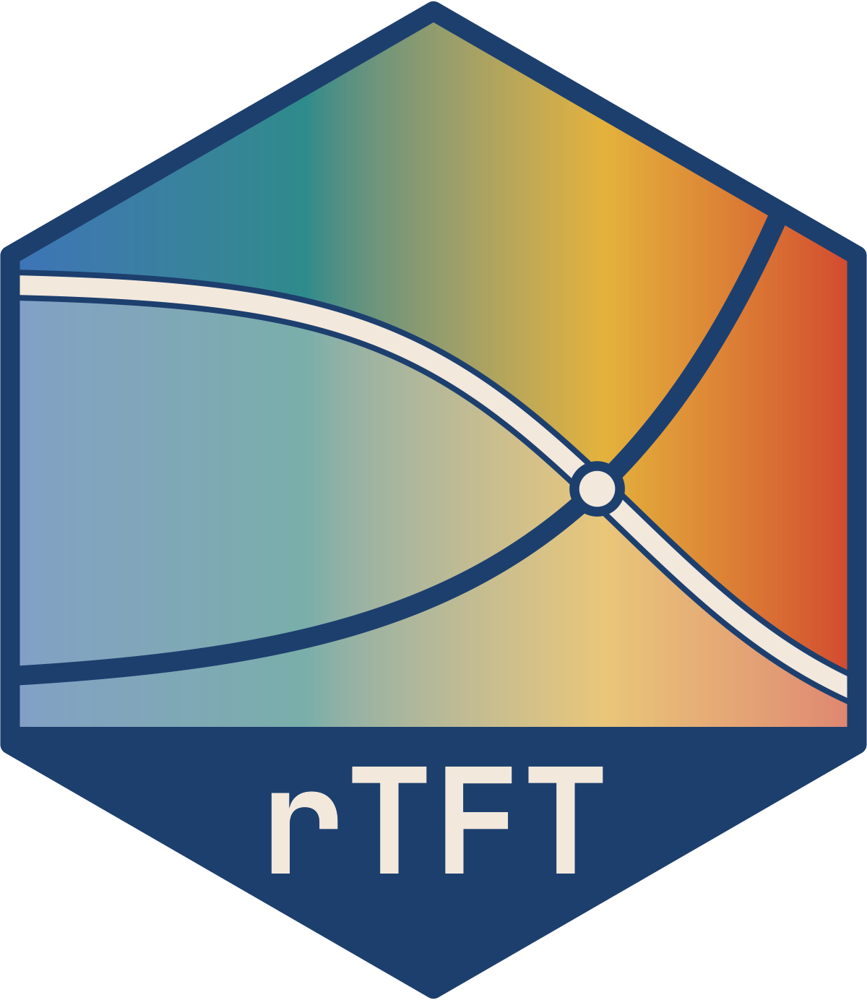

# rTFT: hazard models for thermal failure time data 

<!-- badges: start -->
[](https://lifecycle.r-lib.org/articles/stages.html#experimental)
[](LICENSE.md)
<!-- badges: end -->

`rTFT` fits discrete-time survival models to the times at which individual organisms
fail under thermal exposure (e.g., loss of equilibrium, knockdown or death), using
Bayesian inference in [Stan](https://mc-stan.org) through
[brms](https://paulbuerkner.com/brms/). The hazard is the product of a failure rate
that depends on temperature, following
[Kingsolver and Umbanhowar (2018)](https://doi.org/10.1242/jeb.167858), and a
baseline that may depend on the time under exposure.

Thermal tolerance is usually reported as a summary of an assay, such as the critical
thermal maximum (CTmax) of a ramping trial or the time to failure at a constant
temperature. These summaries depend on how the assay was run (e.g., the ramp rate or
the temperatures chosen). In `rTFT`, a model is fitted to the failure times
themselves (available in both types of assays), and the usual summaries are derived
from the fitted model, each with its posterior uncertainty.

With the package, one can:

- fit failure times that are exact, interval-censored or both, from static assays,
  ramping assays or both, with any of several functions for the failure rate and
  for the baseline;
- let the failure rate depend on covariates (e.g., body mass), on group-level effects
  (e.g., trials) and on other stressors (e.g., dissolved oxygen);
- check the fit of a model against the data;
- derive static and dynamic critical thermal maxima, thermal death time curves and
  thermal tolerance landscapes;
- compare models by cross-validation that leaves out whole individuals or trials,
  and average them;
- predict survival along a record of temperature (e.g., a stream during a heat
  wave), and of any co-stressors recorded with it.

## Installation

`rTFT` is installed from GitHub.

```r
# install.packages("remotes")
remotes::install_github("eogmartins/rTFT", build_vignettes = TRUE)
```

Fitting a model requires a working installation of Stan, through either `cmdstanr`
or `rstan` (see the
[installation notes of brms](https://github.com/paul-buerkner/brms#how-do-i-install-brms)).
`cmdstanr` is recommended and was used to fit the models of the vignettes. It can be asked 
for with `backend = "cmdstanr"` in `fit_hazard()`. 

Building the vignettes requires [Quarto](https://quarto.org).

## Example

Three simulated datasets are included with the package: a static assay
(`static_assay`), a ramping assay run at two levels of dissolved oxygen
(`ramp_assay`) and a record of stream temperature (`stream_record`). They were
simulated from a known model, so that what a model estimates can be compared with
the values used in the simulation.

The example below uses `static_assay`, which contains the times to loss of
equilibrium of 120 juvenile salmonids held at 23, 25 or 27°C and checked every hour
for five days. It shows the four steps of an analysis, which the vignette *Getting
started with rTFT* describes in detail.

```r
library(rTFT)

# 1. The table of intervals at risk, built from the temperature of each treatment
#    through time and the times of the checks.
path   <- data.frame(path_id = rep(c("T23", "T25", "T27"), each = 2),
                     time    = rep(c(0, 7200), times = 3),
                     temp    = rep(c(23, 25, 27), each = 2))
checks <- expand.grid(path_id = c("T23", "T25", "T27"), time = seq(0, 7200, by = 60))
long   <- build_hazard_data(static_assay, path, observation = "interval",
                            covariates = c("mass", "trial"), checks = checks)

# 2. An exponential failure rate with a Weibull baseline, with the failure rate
#    depending on body mass and varying among trials.
fit <- fit_hazard(long, m_form = "exp", baseline = "weibull",
                  dpar_formulas = list(loga = ~ 1 + I(mass - 15) + (1 | trial)),
                  chains = 4, cores = 4, backend = "cmdstanr")

# 3. The static critical thermal maximum for an exposure of 60 min and the thermal
#    death time curves of a 15 g fish.
tol <- derive_tdt_ttl(fit, newdata = data.frame(mass = 15), t_ref = 60)
tol$sctmax
plot_tdt(tol, time_unit = "min")

# 4. Survival along 30 days of hourly stream temperature.
pred <- predict_survival(fit, stream_record, newdata = data.frame(mass = 15))
plot_survival(pred, temperature = TRUE)
```

## Vignettes

Four vignettes describe the package, and are best read in this order. They can be
read, with the help pages, on the [website of the package](https://eogmartins.github.io/rTFT/).

1. *Getting started with rTFT* (`vignette("getting-started", package = "rTFT")`):
   the model, a static assay, the checks of a fitted model, the derived quantities
   and a prediction of survival along a record of stream temperature.
2. *Ramping assays* (`vignette("ramping-assays", package = "rTFT")`): how a ramp is
   given to the package, the dynamic critical thermal maximum, and what the choice
   of ramp rates allows a model to estimate.
3. *Comparing and averaging models*
   (`vignette("comparing-and-averaging-models", package = "rTFT")`): cross-validation
   by individual or trial, model weights and averaged predictions.
4. *Temperature and a co-stressor*
   (`vignette("temperature-and-a-co-stressor", package = "rTFT")`): dissolved oxygen
   as a second stressor, with and without an interaction with temperature.

## Getting help

Problems and suggestions can be reported at
<https://github.com/eogmartins/rTFT/issues>.

## Citation

If you use the package, please cite it as:

> Martins, E. G. (2026). rTFT: hazard models for thermal failure time data. R package
> version 0.1.0. <https://github.com/eogmartins/rTFT>

The same reference is given by `citation("rTFT")`.

## Use of generative AI

The code, tests and documentation of this package were drafted with the assistance
of Claude (Anthropic), used through Claude Code (models Opus 4.8–5.5 and Fable 5.1).
The author specified the models, their parameterisation and the quantities derived
from them, reviewed each function and its tests before they entered the package, and
takes responsibility for its content.

## Licence

The package is released under the MIT licence (see `LICENSE.md`). As that licence
states, the software is provided "as is", without warranty of any kind.
