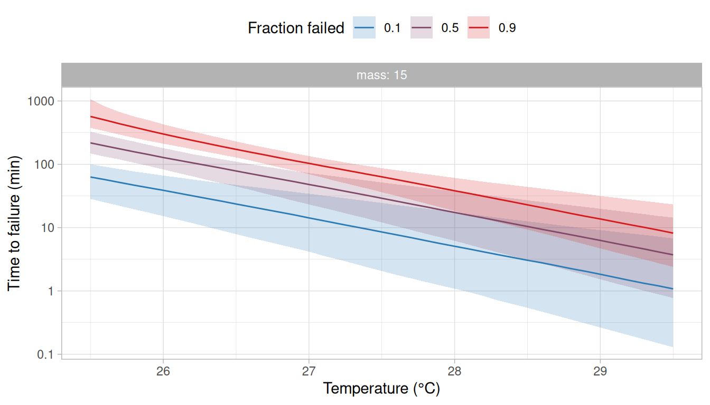
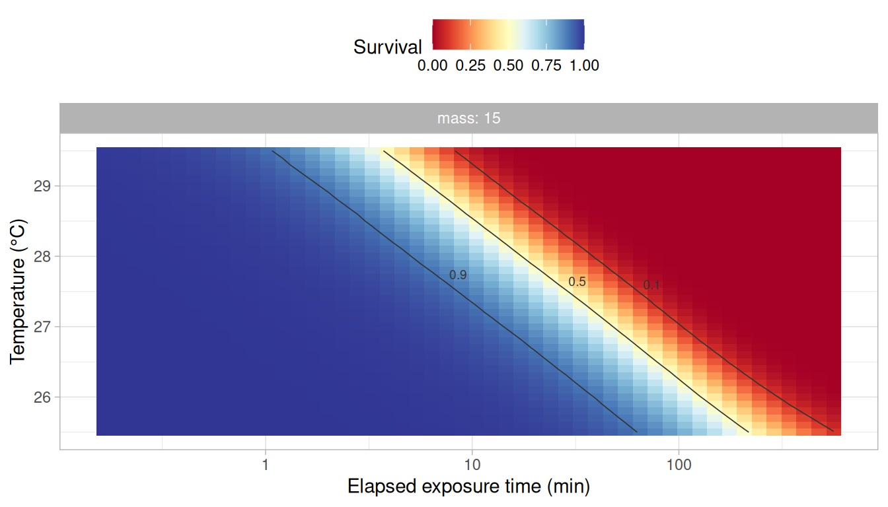
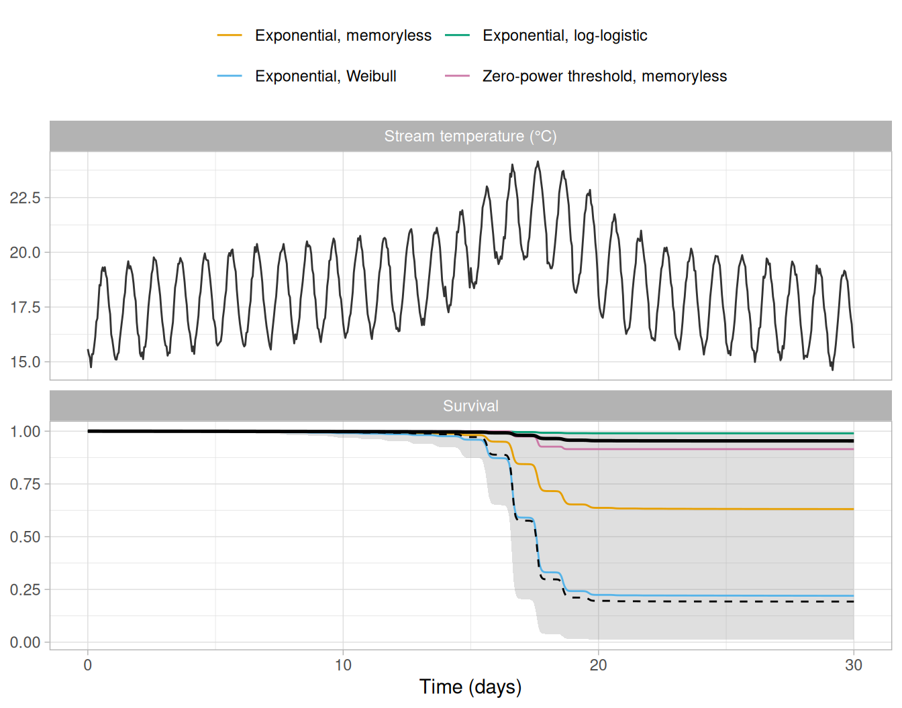

# Comparing and averaging models

A model of thermal failure requires two choices: the function that
describes how the failure rate changes with temperature and the baseline
that describes how the hazard changes with the time under exposure.
`rTFT` offers several functions for each (see
[`?M_catalogue`](https://eogmartins.github.io/rTFT/reference/M_catalogue.md)
and
[`?h0_catalogue`](https://eogmartins.github.io/rTFT/reference/h0_catalogue.md)),
and the data of an assay often do not single one out. This would be of
little consequence if the candidate models gave similar answers.
However, models that describe the failures observed in an assay equally
well may give very different predictions for conditions outside it, such
as a record of stream temperature that lasts longer than the assay.

In this vignette, we fit four models that differ in their failure rate
function or in their baseline to the ramping assay of the vignette
[*Ramping
assays*](https://eogmartins.github.io/rTFT/articles/ramping-assays.md).
We then: (i) compare the models by cross-validation that leaves out
whole trials, (ii) weight them by how well each predicts the trials it
was not fitted to, and (iii) average what is derived from them (i.e.,
the static critical thermal maximum, the thermal death time curves, the
thermal tolerance landscape and the survival predicted along a record of
stream temperature).

``` r

library(rTFT)
library(ggplot2)
```

## The candidate models

We use the 120 fish of `ramp_assay` that were warmed from 14°C at 0.025,
0.1 or 0.3°C per min in normoxia, in four trials of 10 fish at each
rate. These are the rates with the wider span in the vignette [*Ramping
assays*](https://eogmartins.github.io/rTFT/articles/ramping-assays.md),
where the table of intervals at risk is described.

``` r

rates <- c(0.025, 0.1, 0.3)
ramp  <- subset(ramp_assay, do == 10 & rate %in% rates)
path  <- ramp_path(c("r0.025", "r0.1", "r0.3"), T_start = 14, rate = rates,
                   t_max = 15.5 / rates)
long  <- build_hazard_data(ramp, path, observation = "continuous",
                           covariates = c("mass", "trial"))
```

Three of the four models share the exponential failure rate,
$`M(T) = a \exp\{b (T - T_r)\}`$, and differ in the baseline
$`h_0(\tau)`$:

- the memoryless baseline (`"mem"`), under which the hazard at a given
  temperature does not depend on the time under exposure. With the
  exponential failure rate, this is the exponential model of [Kingsolver
  and Umbanhowar (2018)](https://doi.org/10.1242/jeb.167858);
- the Weibull baseline (`"weibull"`), under which the hazard rises or
  falls throughout the exposure, as a power of the time under exposure;
- the log-logistic baseline (`"llogis"`), under which the hazard may
  rise at the start of the exposure and fall later.

Under the first two, the logarithm of the time to failure of individuals
held at a constant temperature decreases linearly with that temperature
(see the vignette [*Getting started with
rTFT*](https://eogmartins.github.io/rTFT/articles/getting-started.md)),
which is the relationship of the thermal death time model, the model
most often used in the literature ([Rezende et
al. 2014](https://doi.org/10.1111/1365-2435.12268)). The two differ in
how the hazard changes with the time under exposure, and therefore in
how the times to failure of the individuals held at one temperature are
spread around that line. Under the log-logistic baseline the
relationship is close to the same line for exposures much shorter than
the scale of the baseline and bends away from it for longer ones, so no
single $`z`$ describes it.

The fourth model has a different failure rate function, the zero-power
threshold of [Kingsolver and Umbanhowar
(2018)](https://doi.org/10.1242/jeb.167858) (`"zeropower_threshold"`),
with the memoryless baseline. Under this function the failure rate is
zero below a critical temperature $`T_c`$, which is estimated, and
increases above it as a power of the temperature in excess of $`T_c`$,
$`M(T) = a (T - T_c)^b`$.

We chose the three baselines because they differ in what the hazard does
with the time under exposure (it stays the same, keeps rising, or rises
and then falls), and the fourth model as a failure rate function of
another family, with a threshold. The other functions of `M_catalogue`
and the Gompertz baseline can be fitted and compared in the same way. In
each model, $`\log a`$ depends on body mass and varies among trials, as
in the previous vignettes. The models are fitted in turn and kept in a
named list, which the functions used below take as their input.

``` r

candidates <- list(
  "Exponential, memoryless"          = c("exp", "mem"),
  "Exponential, Weibull"             = c("exp", "weibull"),
  "Exponential, log-logistic"        = c("exp", "llogis"),
  "Zero-power threshold, memoryless" = c("zeropower_threshold", "mem")
)
fits <- lapply(candidates, \(model) fit_hazard(
  long,
  m_form        = model[1],
  baseline      = model[2],
  dpar_formulas = list(loga = ~ 1 + I(mass - 15) + (1 | trial)),
  chains = 4, iter = 2000, warmup = 1000, cores = 4, seed = 20261006,
  control = list(adapt_delta = 0.95), backend = "cmdstanr"
))
```

The sampler settings are those chosen in the vignette [*Getting started
with
rTFT*](https://eogmartins.github.io/rTFT/articles/getting-started.md)
and were not tuned for these models. Fitting and cross-validating the
models takes about six hours, so the code of this vignette that uses the
fitted models was run once and its results were saved with the package
(see the note at the end of this vignette).

| Model | Largest R-hat | Smallest bulk ESS | Smallest tail ESS | Divergent transitions |
|:---|---:|---:|---:|---:|
| Exponential, memoryless | 1.004 | 758 | 1254 | 1 |
| Exponential, Weibull | 1.002 | 926 | 1290 | 0 |
| Exponential, log-logistic | 1.005 | 863 | 1385 | 0 |
| Zero-power threshold, memoryless | 1.002 | 1814 | 1516 | 0 |

Table 1: Convergence of the four models: the largest $`\hat{R}`$ and the
smallest bulk and tail effective sample sizes among the parameters, and
the number of divergent transitions.

The four models converged ([Table 1](#tbl-convergence)), with 1
divergent transition among the 4,000 draws of one of them. A few
divergent transitions among thousands of draws are not a concern in
themselves when $`\hat{R}`$ and the effective sample sizes are
satisfactory (see the vignette [*Getting started with
rTFT*](https://eogmartins.github.io/rTFT/articles/getting-started.md)).
Each model was also checked against the data with
[`check_survival()`](https://eogmartins.github.io/rTFT/reference/check_survival.md)
and
[`hazard_residuals()`](https://eogmartins.github.io/rTFT/reference/hazard_residuals.md),
as described in the vignette [*Getting started with
rTFT*](https://eogmartins.github.io/rTFT/articles/getting-started.md).

| Model                            | Times outside the band | P (residuals) |
|:---------------------------------|-----------------------:|--------------:|
| Exponential, memoryless          |               0 of 458 |          0.63 |
| Exponential, Weibull             |               0 of 458 |          0.79 |
| Exponential, log-logistic        |               0 of 458 |          0.70 |
| Zero-power threshold, memoryless |              16 of 458 |          0.08 |

Table 2: Fit of each model to the data: the number of observation times,
among all those of the three ramps, at which the proportion of fish
observed to survive was outside the 95% band of the proportions
simulated from the model, and the P-value of a Kolmogorov–Smirnov test
of the residuals against the uniform distribution.

The three models with the exponential failure rate described the data
well: the observed survival was within the simulated band at all times
and the residuals did not depart from the uniform distribution
([Table 2](#tbl-checks)). Under the zero-power threshold model, the
observed survival was outside the band at 16 of the 458 times (10 in the
slowest ramp and 6 in the fastest), and the residuals followed the
uniform distribution less closely. A model that describes the data
poorly would normally be revised or set aside at this point. We keep it
here to show how the cross-validation treats it.

The parameters of each model are obtained with
[`derive_tdt_ttl()`](https://eogmartins.github.io/rTFT/reference/derive_tdt_ttl.md),
as for a single model.

``` r

params <- lapply(fits, \(fit) {
  derive_tdt_ttl(fit, newdata = data.frame(mass = 15), t_ref = 60)$params
})
```

| Model | a | b | Shape (k) | Scale (min) | Tc (°C) |
|:---|---:|---:|---:|---:|---:|
| Exponential, memoryless | 0.0632 (0.0470–0.0840) | 1.44 (1.25–1.68) |  |  |  |
| Exponential, Weibull | 6.51 (4.46–9.23) | 1.54 (1.33–1.81) | 1.32 (1.02–1.64) |  |  |
| Exponential, log-logistic | 26.1 (10.8–68.9) | 1.53 (1.31–1.76) | 1.92 (1.41–2.81) | 257 (133–606) |  |
| Zero-power threshold, memoryless | 3.75e-06 (4.19e-07–2.19e-05) | 5.86 (4.92–6.93) |  |  | 22.0 (21.4–22.4) |

Table 3: Parameters of the four models for a fish of 15 g (posterior
medians and 95% credible intervals). The amplitude $`a`$ and the
exponent $`b`$ are on their natural scale (the models estimate their
logarithms); they are different quantities in models with different
functions and are not comparable among them. The shape and the scale are
those of the baseline, and the critical temperature $`T_c`$ belongs to
the zero-power threshold model only.

## Cross-validation that leaves out whole trials

The models are compared by how well each predicts data that it was not
fitted to. What is left out in the cross-validation determines the
question that it answers. The table of intervals at risk has one row for
each fish and interval, so the usual leave-one-out cross-validation
would leave out a single interval of a fish and predict it from the
other intervals of the same fish, which is nearly always easy. Leaving
out one fish at a time is still optimistic in these models, because the
effect of its trial remains in the fit, estimated from the other fish of
the trial. The function
[`loo_hazard()`](https://eogmartins.github.io/rTFT/reference/loo_hazard.md)
therefore leaves out whole trials by default when the model has a trial
effect, and so assesses how well the model predicts a new trial.

``` r

cv_psis <- lapply(fits, loo_hazard)
```

[`loo_hazard()`](https://eogmartins.github.io/rTFT/reference/loo_hazard.md)
does not refit the model. It approximates the fit without each trial
from the fit to all trials, using Pareto-smoothed importance sampling
([Vehtari et al. 2017](https://doi.org/10.1007/s11222-016-9696-4)). The
approximation is poor when leaving out a trial changes the posterior
distribution markedly, and the function gives a warning when that is the
case for any trial (i.e., when its Pareto $`k`$ diagnostic is above a
threshold of about 0.7).

| Model                            |   elpd |   SE | Largest k | Trials with k \> 0.7 |
|:---------------------------------|-------:|-----:|----------:|---------------------:|
| Exponential, memoryless          | -905.4 | 20.8 |      0.89 |                    4 |
| Exponential, Weibull             | -903.5 | 21.7 |      0.74 |                    2 |
| Exponential, log-logistic        | -903.6 | 22.0 |      0.76 |                    4 |
| Zero-power threshold, memoryless | -914.2 | 24.4 |      0.89 |                    3 |

Table 4: Leave-one-trial-out cross-validation by importance sampling:
the expected log predictive density (elpd) of each model with its
standard error, the largest Pareto $`k`$ among the 12 trials and the
number of trials with $`k`$ above 0.7.

The approximation could not be trusted for 2–4 of the 12 trials in each
model ([Table 4](#tbl-psis)), which is common when a whole trial is left
out: a trial holds a twelfth of the fish and has its own effect in the
model, so the fit changes when it is removed. In this case, the function
[`kfold_hazard()`](https://eogmartins.github.io/rTFT/reference/kfold_hazard.md)
gives the exact answer by refitting the model without each trial in turn
and predicting the trial from the refit.

``` r

cv <- lapply(fits, kfold_hazard, cores = 4, seed = 20261006)
```

Each model is refitted 12 times, once without each trial, which is what
takes most of the time needed to run the code of this vignette. With
many trials, the argument `K` of
[`kfold_hazard()`](https://eogmartins.github.io/rTFT/reference/kfold_hazard.md)
sets a smaller number of refits, each leaving out several trials (see
[`?kfold_hazard`](https://eogmartins.github.io/rTFT/reference/kfold_hazard.md)).
The fits and refits can also be run side by side on a computing cluster
(see the vignette [*Fitting models on a
cluster*](https://eogmartins.github.io/rTFT/articles/fitting-models-on-a-cluster.md)).

``` r

loo::loo_compare(cv)
```

| Model | elpd | SE | Difference in elpd | SE of the difference |
|:---|---:|---:|---:|---:|
| Exponential, log-logistic | -904.5 | 22.0 | 0.0 | 0.0 |
| Exponential, Weibull | -904.5 | 21.7 | 0.0 | 2.3 |
| Exponential, memoryless | -905.9 | 20.6 | -1.4 | 2.1 |
| Zero-power threshold, memoryless | -920.8 | 28.7 | -16.3 | 13.7 |

Table 5: Comparison of the four models by cross-validation that leaves
out one trial at a time, by refitting. The difference in elpd and its
standard error are relative to the model with the highest elpd.

The three models with the exponential failure rate could not be told
apart. Their elpd differed by at most 1.4, which is less than the
standard errors of the differences ([Table 5](#tbl-compare)). The
zero-power threshold model predicted the trials left out worse than the
others (a difference of -16.3), although its difference from the best
model was only 1.2 times its standard error. These standard errors are
computed among 12 trials and are themselves uncertain, so differences of
this size should not be read as evidence that one model is better than
another.

For the three exponential models, the elpd obtained by refitting was
within 1.0 of that obtained by importance sampling
([Table 4](#tbl-psis)). For the zero-power threshold model it was 7
lower (-920.8 against -914.2). The warning of
[`loo_hazard()`](https://eogmartins.github.io/rTFT/reference/loo_hazard.md)
indicates only that the approximation cannot be relied on for the trials
concerned, and not in which direction it errs. The comparison with the
refits shows that, for this model, importance sampling gave an elpd that
was too high.

## Model weights

The function
[`hazard_weights()`](https://eogmartins.github.io/rTFT/reference/hazard_weights.md)
turns the results of the cross-validation into weights for averaging the
models. By default it uses stacking ([Yao et
al. 2018](https://doi.org/10.1214/17-BA1091)), which finds the
combination of models that best predicts the trials left out. Pseudo-BMA
weights, which follow the elpd of each model with its uncertainty among
the trials, are the alternative. That uncertainty is assessed by the
Bayesian bootstrap (the weights are then those called pseudo-BMA+ by Yao
et al. 2018), which draws random numbers, so we set a seed before
computing them.

``` r

w <- hazard_weights(cv)
set.seed(20261006)
w_pseudobma <- hazard_weights(cv, method = "pseudobma")
```

| Model                            | Stacking | Pseudo-BMA |
|:---------------------------------|---------:|-----------:|
| Exponential, log-logistic        |     0.50 |       0.41 |
| Exponential, Weibull             |     0.50 |       0.44 |
| Zero-power threshold, memoryless |     0.00 |       0.01 |
| Exponential, memoryless          |     0.00 |       0.14 |

Table 6: Weights of the four models by stacking and as pseudo-BMA
weights.

Stacking gave nearly all of the weight to two models, the exponential
failure rate with the log-logistic baseline (0.50) and with the Weibull
baseline (0.50) ([Table 6](#tbl-weights)). The memoryless model received
a weight of 0.00 although its elpd was within 1.4 of the best. This is
how stacking treats a model whose predictions for the trials left out
are close to those of models already in the combination: it adds nothing
to the combination and receives no weight, even though it would predict
almost as well on its own. Which of several similar models receives the
weight depends on small differences in how each of them combines with
the others to predict the trials left out, so a weight of zero should
not be read as evidence against a model. The pseudo-BMA weights follow
the elpd of each model instead, and gave the memoryless model a weight
of 0.14. Under both methods the zero-power threshold model received
almost no weight. Weights computed from 12 trials are themselves
uncertain, and a different sample of trials could move them.

We use the stacking weights below, and the pseudo-BMA weights where the
two are compared. With the argument `min_weight`,
[`hazard_weights()`](https://eogmartins.github.io/rTFT/reference/hazard_weights.md)
keeps only the models with the highest weights, as many as needed for
their weights to reach the given total (e.g., `min_weight = 0.95`), and
computes the weights again among them.

## Thermal tolerance averaged over the models

The function
[`average_tdt_ttl()`](https://eogmartins.github.io/rTFT/reference/average_tdt_ttl.md)
derives the static critical thermal maximum (sCTmax), the thermal death
time curves and the thermal tolerance landscape from the models and
averages them, and
[`average_dctmax()`](https://eogmartins.github.io/rTFT/reference/average_dctmax.md)
does the same for the dynamic critical thermal maximum (dCTmax). For
each quantity, the posterior draws of the models are pooled in
proportion to their weights and the pool is summarised, so the credible
interval reflects both the uncertainty within each model and the
uncertainty about which model predicts best. The parameters are not
averaged, because the parameters of models with different functions are
different quantities under the same names (e.g., with the exponential
failure rate, $`a`$ is the failure rate per minute at the reference
temperature under the memoryless baseline, and the cumulative hazard
reached over the reference time at that temperature under the Weibull
baseline; see
[`?M_catalogue`](https://eogmartins.github.io/rTFT/reference/M_catalogue.md)).

``` r

avg <- average_tdt_ttl(fits, w, newdata = data.frame(mass = 15), t_ref = 60,
                       Ta = seq(25.5, 29.5, by = 0.1))
avg_dct <- average_dctmax(fits, w, rate = c(0.01, 0.3, 1), T_start = 14,
                          newdata = data.frame(mass = 15))
```

The argument `Ta` restricts the thermal death time curves to the
temperatures at which most fish failed in the ramps (see the vignette
[*Ramping
assays*](https://eogmartins.github.io/rTFT/articles/ramping-assays.md)).
At lower temperatures the data do not constrain the form of the models,
and the times to failure derived from the four models differ by many
orders of magnitude. The average can be computed for those temperatures,
but it is very uncertain there, and its credible interval should be read
in preference to its median.

| Model | sCTmax, 60 min | dCTmax, 0.01°C per min | dCTmax, 0.3°C per min | dCTmax, 1°C per min |
|:---|---:|---:|---:|---:|
| Exponential, memoryless | 26.2 (26.0–26.5) | 26.1 (25.8–26.5) | 28.5 (28.3–28.7) | 29.3 (29.1–29.6) |
| Exponential, Weibull | 26.7 (26.2–27.1) | 25.8 (25.4–26.3) | 28.7 (28.4–28.9) | 29.7 (29.3–30.1) |
| Exponential, log-logistic | 26.9 (26.4–27.3) | 26.6 (26.1–27.0) | 28.8 (28.5–29.1) | 30.2 (29.7–31.0) |
| Zero-power threshold, memoryless | 25.9 (25.7–26.1) | 26.0 (25.7–26.2) | 28.5 (28.3–28.8) | 29.8 (29.5–30.2) |
| Average | 26.8 (26.3–27.3) | 26.2 (25.5–26.9) | 28.7 (28.5–29.0) | 29.9 (29.4–30.8) |

Table 7: Static critical thermal maximum (sCTmax, °C) of a 15 g fish for
an exposure of 60 min, from each model and averaged over the models, and
its dynamic critical thermal maximum (dCTmax, °C) under ramps from 14°C
at three rates, from each model and averaged over the models with the
stacking weights. Values are posterior medians and 95% credible
intervals.

The models agreed closely on the quantity that the assay measured
directly. The dCTmax at 0.3°C per min, one of the rates of the assay,
was 28.5–28.8°C among the four models ([Table 7](#tbl-sctmax)). They
agreed less on quantities further from the conditions of the assay: the
dCTmax was 25.8–26.6°C at 0.01°C per min and 29.3–30.2°C at 1°C per min,
and the sCTmax for 60 min was 25.9–26.9°C. Averaged over the models, the
sCTmax was 26.8°C (95% credible interval: 26.3–27.3°C), an interval
wider than that of any of the models because it also includes the
uncertainty among models. The average changed little with the weights
used: with the pseudo-BMA weights the sCTmax was 26.7°C (26.1–27.2°C).

The thermal death time curves and the thermal tolerance landscape
averaged over the models are drawn with
[`plot_tdt()`](https://eogmartins.github.io/rTFT/reference/plot_tdt.md)
and
[`plot_ttl()`](https://eogmartins.github.io/rTFT/reference/plot_ttl.md),
as for a single model ([Figure 1](#fig-tdt); [Figure 2](#fig-ttl)).

``` r

plot_tdt(avg, time_unit = "min")
```



Figure 1: Thermal death time curves for a fish of 15 g, averaged over
the four models. Lines are medians and bands are 95% credible intervals
of the pooled posterior draws.

``` r

plot_ttl(avg, time_unit = "min")
```



Figure 2: Thermal tolerance landscape for a fish of 15 g, averaged over
the four models. Colours show the median of the pooled posterior draws
of the probability of survival and lines are contours at the labelled
probabilities.

## Survival along a record of stream temperature

The function
[`average_survival()`](https://eogmartins.github.io/rTFT/reference/average_survival.md)
does the same for the survival predicted along a record of temperature.
We use the 30 days of `stream_record`, as in the previous vignettes, and
also predict from each model on its own to see what the average is made
of.

``` r

fish     <- data.frame(mass = 15)
each     <- lapply(fits, predict_survival, record = stream_record, newdata = fish)
averaged <- average_survival(fits, w, stream_record, newdata = fish)
# the same with the pseudo-BMA weights
averaged_pseudobma <- average_survival(fits, w_pseudobma, stream_record, newdata = fish)
```

``` r

panels <- c("Stream temperature (°C)", "Survival")
temperature <- data.frame(panel = panels[1], time = stream_record$time,
                          temp = stream_record$temp)
by_model <- do.call(rbind, lapply(names(each), \(m) {
  data.frame(panel = panels[2], model = m, each[[m]]$survival)
}))
pooled <- data.frame(panel = panels[2], averaged$survival)
# simulated_survival holds the survival under the model used to simulate the data,
# computed as in the vignette Ramping assays

# The panels and the models share one order in the four tables.
temperature$panel        <- factor(temperature$panel, levels = panels)
by_model$panel           <- factor(by_model$panel, levels = panels)
pooled$panel             <- factor(pooled$panel, levels = panels)
simulated_survival$panel <- factor(simulated_survival$panel, levels = panels)
by_model$model    <- factor(by_model$model, levels = names(each))

ggplot(mapping = aes(x = time / 1440)) +
  geom_line(data = temperature, aes(y = temp), colour = "grey20") +
  geom_ribbon(data = pooled, aes(ymin = lower, ymax = upper), fill = "grey50", alpha = 0.25) +
  geom_line(data = by_model, aes(y = median, colour = model)) +
  geom_line(data = pooled, aes(y = median), colour = "black", linewidth = 0.9) +
  geom_line(data = simulated_survival, aes(y = survival), colour = "black",
            linetype = "dashed") +
  scale_colour_manual(values = c("#E69F00", "#56B4E9", "#009E73", "#CC79A7"), name = NULL) +
  facet_wrap(vars(panel), ncol = 1, scales = "free_y") +
  labs(x = "Time (days)", y = NULL) +
  theme_light() +
  theme(legend.position = "top") +
  guides(colour = guide_legend(nrow = 2))
```



Figure 3: Stream temperature (top) and the probability of survival of a
15 g fish along it (bottom), predicted by each of the four models
(coloured lines are posterior medians) and averaged over them (the black
line is the median and the band is the 95% credible interval of the
pooled posterior draws). The dashed line is the survival under the model
used to simulate the data.

| Model | Stacking weight | Pseudo-BMA weight | Mean | Median | 95% CrI |
|:---|---:|---:|---:|---:|---:|
| Exponential, memoryless | 0.00 | 0.14 | 38 | 37 | 14–66 |
| Exponential, Weibull | 0.50 | 0.44 | 74 | 78 | 31–100 |
| Exponential, log-logistic | 0.50 | 0.41 | 1 | 1 | 0–3 |
| Zero-power threshold, memoryless | 0.00 | 0.01 | 10 | 9 | 3–22 |
| Average, stacking weights |  |  | 37 | 5 | 0–99 |
| Average, pseudo-BMA weights |  |  | 38 | 32 | 0–99 |

Table 8: Probability (%) that a 15 g fish fails by the end of the 30
days of the stream record, predicted by each model (with its stacking
and pseudo-BMA weights) and averaged over the models with each set of
weights. The mean and the median are two summaries of the same posterior
distribution, whose 95% credible interval (CrI) is given once.

The four models gave very different predictions for the same record
([Figure 3](#fig-survival); [Table 8](#tbl-mortality)). The probability
of failing by the end of the 30 days was 1% (0–3%) under the
log-logistic baseline, 9% (3–22%) under the zero-power threshold model,
37% (14–66%) under the exponential model with the memoryless baseline
and 78% (31–100%) under the Weibull baseline. The two models that
cross-validation weighted the most, and could not tell apart, gave the
two most distant predictions.

The models differ because the record lasts much longer than the assay.
The longest exposure in the assay was 9.4 h, and 100% of the risk
predicted along the record was accrued after that time, as the message
of
[`predict_survival()`](https://eogmartins.github.io/rTFT/reference/predict_survival.md)
and its table `coverage` report (see the vignette [*Ramping
assays*](https://eogmartins.github.io/rTFT/articles/ramping-assays.md)).
Over the exposures of the assay the three baselines describe the
failures equally well. Beyond them they diverge. Under the Weibull
baseline, the hazard at a given temperature keeps rising with the time
under exposure. Under the memoryless baseline, it stays the same. Under
the log-logistic baseline, it falls after an initial rise, and it is
under this baseline alone that the heat wave carries almost no risk,
because it comes after two weeks of exposure. Where that fall begins is
set by the scale of the log-logistic baseline (its hazard turns down at
about 245 min on the posterior medians, against a longest exposure of
561 min in the assay), which the data inform only weakly (see
[`?h0_catalogue`](https://eogmartins.github.io/rTFT/reference/h0_catalogue.md)),
so the posterior of that scale rests partly on its prior, and so does
the prediction of this model for the record. The zero-power threshold
model predicts few failures for another reason, which is that its
failure rate is zero below the critical temperature $`T_c`$, estimated
at 22.0°C (95% credible interval: 21.4–22.4°C; [Table 3](#tbl-params)),
and the stream exceeded that temperature only during the afternoons of
the heat wave.

The average reflects this disagreement. With the stacking weights, its
95% credible interval was 0–99%, which includes nearly every possible
outcome, and its median was 5%.

The median is not a value between the predictions of the two models with
the highest weights, as might be expected of an average. A model average
is a mixture of the posterior distributions of the models, in which each
model contributes posterior draws in proportion to its weight, and what
is reported is the median and the interval of that mixture. Here, about
half of the draws came from the log-logistic model (501 of 1000), all of
which predict a mortality of a few percent, and about half from the
Weibull model (499), nearly all of which predict a mortality above 30%,
with almost no draws in between. The median of a mixture with two
separate groups of values lies at the edge of whichever group holds
slightly more than half of the draws, and a small change in the weights,
or in the number of draws each model happens to contribute, moves it
from one group to the other. With the pseudo-BMA weights, the interval
was nearly the same (0–99%) but the median was 32%.

This is a consequence of the disagreement among the models, and not of
model averaging. Where the models agree, as for the sCTmax above, the
average is nearly the same under either set of weights and its median
summarises it well. Where they disagree as much as they do for this
record, no single value summarises the average, and the interval and the
predictions of each model should be reported with whichever value is
given.

[`predict_survival()`](https://eogmartins.github.io/rTFT/reference/predict_survival.md)
and
[`average_survival()`](https://eogmartins.github.io/rTFT/reference/average_survival.md)
report the mean of the posterior draws beside their median
([Table 8](#tbl-mortality)), and the two mean different things. For a
probability such as mortality, the mean is the probability that a fish
fails once the uncertainty in the parameters, and in the model as far as
the weights measure it, is taken into account. It is therefore the
fraction of fish expected to fail. The median is the value below which
half of the posterior lies, and it describes the posterior well when its
values form a single group. The credible interval belongs to the
posterior distribution and not to either of its summaries, so it is the
same whichever of the two is reported. For each model on its own, the
two differed by at most 4 percentage points.

For the average they differed greatly. The mean was 37% with the
stacking weights and 38% with the pseudo-BMA weights, against medians of
5% and 32%, so the mean changed little with the weights. The mean of the
pooled draws is the prediction that stacking is built to give, and
relying on it amounts to treating the weights as the degree to which
each model should be believed for this record. The weights measure how
well each model predicts within the conditions of the assay, which is
not the same, and the mean of 37% is a value that neither of the two
models with the highest weights predicts: it is what is expected on
average when the mortality is either about 1% or about 78%. Relying on
the median amounts to reporting the centre of a posterior that has no
centre here. Where the models agree, the choice is of no consequence:
for the warmest day of the record (see below), the mean and the median
of the average were 14% and 13%.

The weights indicate how well each model predicts failures under the
conditions of the assay. They do not indicate which model extrapolates
better beyond those conditions, which the data of the assay cannot show.

All of these predictions also assume that there is no recovery: the
hazard accrued during a warm afternoon is carried through the following
night, although the stream cooled to 18–20°C every night of the heat
wave. The model used to simulate the data makes the same assumption, so
the agreement of a prediction with the simulated value says nothing
about whether the assumption holds. In a real stream, fish are expected
to recover at least in part during the cooler hours ([Ørsted et
al. 2022](https://doi.org/10.1242/jeb.244514)), in which case every
model would overestimate the mortality over a sequence of warm days, by
an amount that an assay such as this one, with a single ramp for each
fish, was not designed to estimate (see the vignette [*Getting started
with
rTFT*](https://eogmartins.github.io/rTFT/articles/getting-started.md)).

## Comparison with the model used to simulate the data

The data were simulated from an exponential failure rate with a Weibull
baseline (see
[`?ramp_assay`](https://eogmartins.github.io/rTFT/reference/ramp_assay.md)),
so one of the four candidates has the form of the model that generated
them. The model used to simulate the data gives an sCTmax for 60 min of
27.0°C and a mortality of 81% along the stream record, which are close
to the estimates of the candidate fitted with the Weibull baseline
(26.7°C and 78%).

Cross-validation did not identify that candidate. The Weibull and the
log-logistic baselines predicted the trials left out equally well, and
stacking gave them weights of 0.50 and 0.50. An assay with exposures of
at most 9.4 h does not contain the information needed to choose between
two baselines that differ in what they imply for exposures of weeks.

This does not mean that a ramping assay cannot support predictions for
the field. Predictions are more often needed for a warm period (e.g., a
heat wave) than for a whole record that includes weeks at temperatures
that cause no failures, and the disagreement among the models depends on
how much longer the period is than the exposures of the assay, as
predictions for shorter parts of the same record show.

``` r

# the warmest day of the record, with its exposure counted from the start of the day
warmest_day      <- subset(stream_record, day == 18)
warmest_day$time <- warmest_day$time - warmest_day$time[1]
lapply(fits, \(fit) predict_survival(fit, warmest_day, newdata = fish)$mortality)
average_survival(fits, w, warmest_day, newdata = fish)$mortality
```

| Model | 30 days | Heat wave, 5 days | Warmest day, 24 h |
|:---|---:|---:|---:|
| Exponential, memoryless | 37 (14–66) \[38\] | 35 (14–63) \[36\] | 15 (6–30) \[16\] |
| Exponential, Weibull | 78 (31–100) \[74\] | 53 (24–86) \[54\] | 18 (8–34) \[19\] |
| Exponential, log-logistic | 1 (0–3) \[1\] | 8 (3–19) \[9\] | 9 (4–19) \[10\] |
| Zero-power threshold, memoryless | 9 (3–22) \[10\] | 9 (3–22) \[10\] | 5 (2–12) \[6\] |
| Average | 5 (0–99) \[37\] | 21 (3–83) \[31\] | 13 (4–30) \[14\] |
| Model used to simulate the data | 81 | 45 | 12 |

Table 9: Probability (%) that a 15 g fish fails by the end of the whole
stream record, of the five days of its heat wave (days 16 to 20) and of
its warmest day (day 18), predicted by each model and averaged over the
models with the stacking weights (posterior medians and 95% credible
intervals, with posterior means in brackets), with the value given by
the model used to simulate the data. For the two shorter periods, the
exposure is counted from their first reading.

For the warmest day alone, the four models predicted a mortality of
5–18%, and their average was 13% (95% credible interval: 4–30%), against
12% under the model used to simulate the data ([Table 9](#tbl-shorter)).
For the five days of the heat wave they predicted 8–53% (45% under the
model used to simulate the data), and for the 30 days 1–78% (81%). A
ramping assay therefore supports best the predictions for events that
last about as long as its trials (e.g., a hot afternoon or a hot day),
for which the choice of baseline matters little. These predictions count
the exposure from the start of the event, and so assume that the days
before it left no effect on the fish. As above, they also assume no
recovery during the event, which matters more the more cool nights it
includes.

For longer periods, the predictions of the models with the highest
weights can be reported together as the range of outcomes that the assay
cannot distinguish. Where predictions over long periods are the aim, the
assay should also include the longest trials that are practical (e.g.,
static trials of several days, as in the vignette [*Getting started with
rTFT*](https://eogmartins.github.io/rTFT/articles/getting-started.md)),
which narrow that range although they do not remove it.

## Reporting

When several candidate models are fitted, we recommend reporting: (i)
the comparison of the models and their weights, with the unit that was
left out and the number of units (here, 12 trials); (ii) for the
quantities that refer to the conditions of the assay (e.g., the dCTmax
at the rates that were run), the estimates of the models with the
highest weights or their average, which differ little; and (iii) for
predictions outside the conditions of the assay, the prediction of each
model alongside the average, with the interval of the average, its mean
and its median where they differ, and the coverage reported by
[`predict_survival()`](https://eogmartins.github.io/rTFT/reference/predict_survival.md).

> **Precomputed results**
>
> The models in this vignette were fitted and cross-validated on
> 2026-10-08 with the development version of `rTFT` that became 0.1.0
> (0.0.0.9000), by the script `vignettes/_precompute.R` in the package’s
> repository. The vignette displays the saved summaries, and all other
> code runs when the vignette is built.

## References

Kingsolver, J. G. and Umbanhowar, J. (2018). The analysis and
interpretation of critical temperatures. *Journal of Experimental
Biology* 221, jeb167858.
[https://doi.org/10.1242/jeb.167858](https://doi.org/10.1242/jeb.167858)

Ørsted, M., Jørgensen, L. B. and Overgaard, J. (2022). Finding the right
thermal limit: a framework to reconcile ecological, physiological and
methodological aspects of CTmax in ectotherms. *Journal of Experimental
Biology* 225, jeb244514.
[https://doi.org/10.1242/jeb.244514](https://doi.org/10.1242/jeb.244514)

Rezende, E. L., Castañeda, L. E. and Santos, M. (2014). Tolerance
landscapes in thermal ecology. *Functional Ecology* 28, 799–809.
[https://doi.org/10.1111/1365-2435.12268](https://doi.org/10.1111/1365-2435.12268)

Vehtari, A., Gelman, A. and Gabry, J. (2017). Practical Bayesian model
evaluation using leave-one-out cross-validation and WAIC. *Statistics
and Computing* 27, 1413–1432.
[https://doi.org/10.1007/s11222-016-9696-4](https://doi.org/10.1007/s11222-016-9696-4)

Yao, Y., Vehtari, A., Simpson, D. and Gelman, A. (2018). Using stacking
to average Bayesian predictive distributions. *Bayesian Analysis* 13,
917–1007.
[https://doi.org/10.1214/17-BA1091](https://doi.org/10.1214/17-BA1091)
