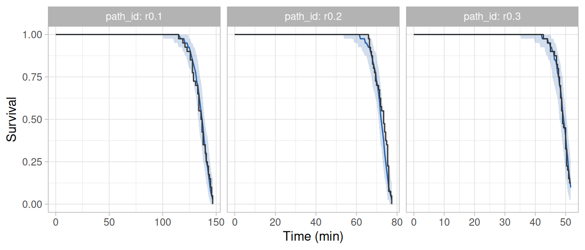
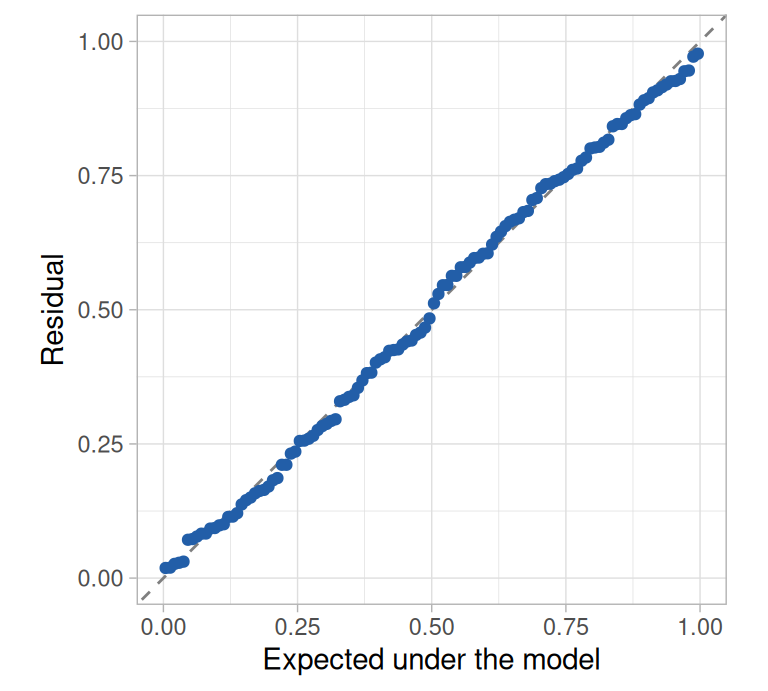
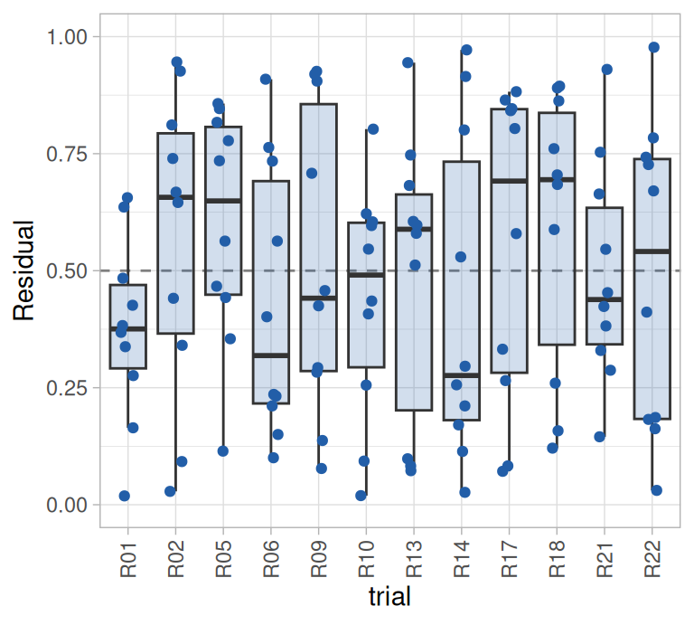
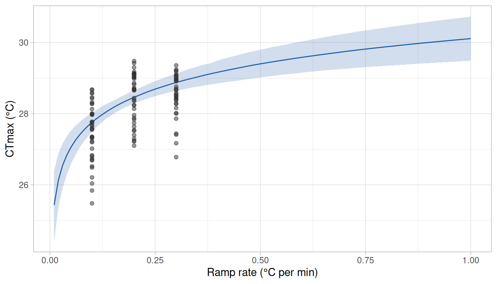
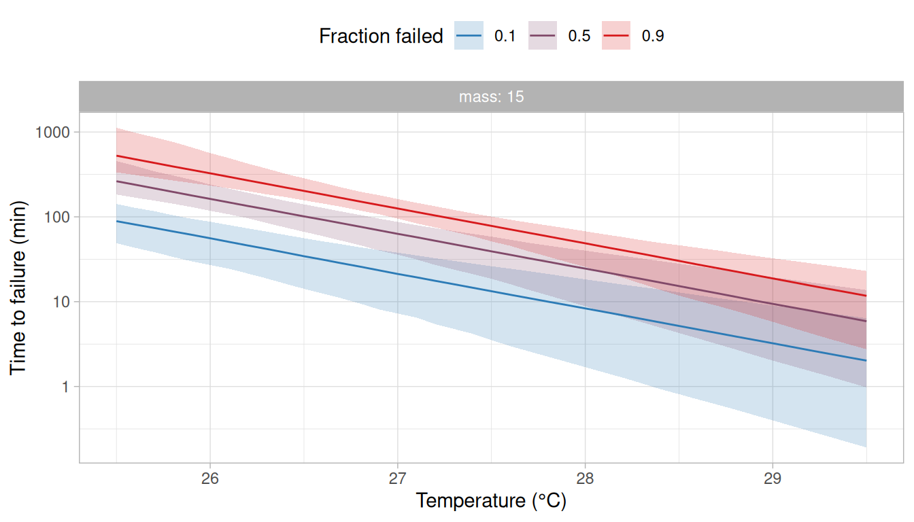
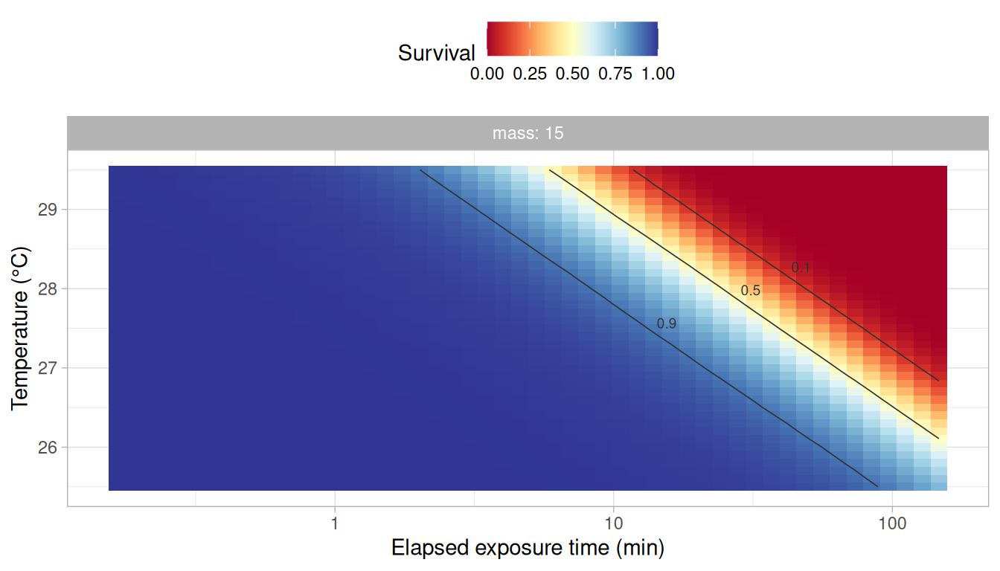
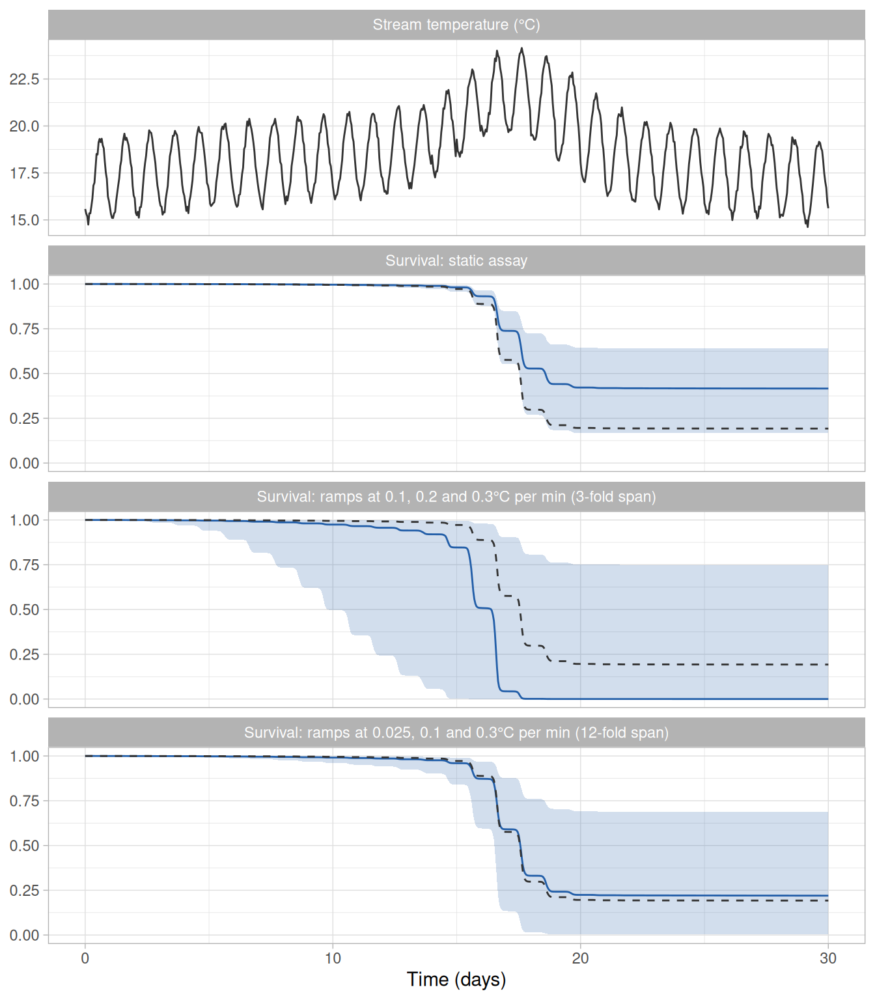

# Ramping assays

In a ramping assay, individuals are warmed at a constant rate until they
fail, and the temperature at which each individual fails is recorded as
its critical thermal maximum (CTmax, or dCTmax *sensu* [Jørgensen et
al. 2021](https://doi.org/10.1038/s41598-021-92004-6)). The mean CTmax
of a group of individuals is the most widely reported measure of thermal
tolerance. However, it depends on the temperature at which the ramp
started and on the ramp rate, because individuals accrue hazard
throughout the ramp ([Kingsolver and Umbanhowar
2018](https://doi.org/10.1242/jeb.167858); [Jørgensen et
al. 2021](https://doi.org/10.1038/s41598-021-92004-6)). `rTFT` therefore
treats a ramping assay as it treats a static one: it fits a model of the
failure rate to the times of failure, given the temperature each
individual was exposed to through time, and derives the CTmax expected
under any ramp from the fitted model.

In this vignette, we fit a model to a ramping assay run at three rates
(0.1, 0.2 and 0.3°C per min) and derive from it: (i) the dynamic
critical thermal maximum (dCTmax; i.e., the CTmax expected of a ramping
trial) under the ramps of the assay and under ramps that were not run,
(ii) the static critical thermal maximum (sCTmax), (iii) the thermal
death time curves and (iv) the thermal tolerance landscape. We then show
that what the model can estimate from a ramping assay depends on the
ramp rates that were run, and mainly on how much they differ (i.e., on
the ratio between the fastest and the slowest rate). For that, we fit
the same model to an assay of the same size in which the slowest rate
was 0.025°C per min, and compare what the two assays allow the model to
estimate and predict. We also describe two steps that are specific to
ramping assays, which are how the temperature of each ramp is given to
the package and how closely the ramp is followed when the model is
fitted. The model and the steps shared with a static assay are described
in more detail in the vignette [*Getting started with
rTFT*](https://eogmartins.github.io/rTFT/articles/getting-started.md).

``` r

library(rTFT)
library(ggplot2)
```

## The ramping assay

The mock dataset `ramp_assay` holds the times to loss of equilibrium of
320 juvenile salmonids warmed from 14°C at a constant rate until they
failed or the water reached 29.5°C, in trials of ten fish. Four rates
(0.025, 0.1, 0.2 and 0.3°C per min) were each run in four trials in
normoxia (10 mg/L of dissolved oxygen) and four in hypoxia (5 mg/L). The
fish were watched throughout the ramp, so the time of each failure is
known (to the nearest 0.1 min). We start with the 120 fish warmed at the
three faster rates in normoxia, and use the trials at the slow rate in
the section [*The choice of ramp rates*](#sec-rates). The effect of
dissolved oxygen is the subject of the vignette [*Temperature and a
co-stressor*](https://eogmartins.github.io/rTFT/articles/temperature-and-a-co-stressor.md).

> **Note**
>
> The data were simulated from the same model as the static assay of the
> vignette [*Getting started with
> rTFT*](https://eogmartins.github.io/rTFT/articles/getting-started.md)
> (see
> [`?ramp_assay`](https://eogmartins.github.io/rTFT/reference/ramp_assay.md)),
> so we can compare what we estimate against the values used in the
> simulation.

``` r

ramp <- subset(ramp_assay, do == 10 & rate %in% c(0.1, 0.2, 0.3))
head(ramp)
#> # A tibble: 6 × 8
#>      id trial path_id  rate    do  mass event t_event
#>   <int> <chr> <chr>   <dbl> <dbl> <dbl> <int>   <dbl>
#> 1     1 R01   r0.1      0.1    10  10.2     1    136.
#> 2     2 R01   r0.1      0.1    10  18.3     1    133.
#> 3     3 R01   r0.1      0.1    10  15.2     1    132 
#> 4     4 R01   r0.1      0.1    10  26.3     1    130.
#> 5     5 R01   r0.1      0.1    10  23.8     1    125.
#> 6     6 R01   r0.1      0.1    10  18.6     1    132.
```

Each row is a fish. The column `event` is 1 for a fish that failed and 0
for a survivor, and `t_event` is the time (min) at which the fish
failed, or at which the ramp ended for a survivor. The column `path_id`
links each fish to the ramp it was exposed to. The CTmax of a fish is
the temperature that the ramp had reached when the fish failed, which
follows from the starting temperature, the rate and the time of failure.

``` r

ramp$ctmax <- 14 + ramp$rate * ramp$t_event
observed <- ramp |>
  dplyr::summarise(
    n_fish       = dplyr::n(),
    n_failed     = sum(event),
    median_time  = median(t_event),
    median_ctmax = median(ctmax),
    .by = rate
  )
observed
#> # A tibble: 3 × 5
#>    rate n_fish n_failed median_time median_ctmax
#>   <dbl>  <int>    <int>       <dbl>        <dbl>
#> 1   0.1     40       40       136.          27.6
#> 2   0.2     40       40        73.4         28.7
#> 3   0.3     40       35        49.0         28.7
```

All fish failed at the two slower rates, and 5 of the 40 fish warmed at
0.3°C per min reached 29.5°C without failing. The survivors are counted
at 29.5°C in the table. This does not change the median, because fewer
than half of the fish survived and all of them outlasted the fish that
failed, so the median is the CTmax of fish that failed. The median CTmax
increased with the ramp rate, from 27.6°C at 0.1°C per min to 28.7°C at
0.3°C per min, although the fish of the three groups were simulated with
the same thermal tolerance. The fish in the slowest ramp had been
exposed for more than twice as long when they failed (136 min against 49
min), and they failed at a lower temperature because they had more time
to accrue hazard before each temperature was reached.

## The temperature of each ramp

The function
[`build_hazard_data()`](https://eogmartins.github.io/rTFT/reference/build_hazard_data.md)
requires the temperature that each group of fish was exposed to through
time, as a table of times and temperatures for each `path_id`. It
interpolates the table linearly, so a ramp at a constant rate needs only
its first and last points.

### Nominal ramps

The function
[`ramp_path()`](https://eogmartins.github.io/rTFT/reference/ramp_path.md)
builds the table from the starting temperature, the rate and the
duration of each ramp. Each ramp of the assay spanned 15.5°C (from 14 to
29.5°C), so its duration is 15.5°C divided by its rate.

``` r

rates <- c(0.1, 0.2, 0.3)
path  <- ramp_path(c("r0.1", "r0.2", "r0.3"), T_start = 14, rate = rates,
                   t_max = 15.5 / rates)
path
#> # A tibble: 6 × 3
#>   path_id  time  temp
#>   <chr>   <dbl> <dbl>
#> 1 r0.1      0    14  
#> 2 r0.1    155    29.5
#> 3 r0.2      0    14  
#> 4 r0.2     77.5  29.5
#> 5 r0.3      0    14  
#> 6 r0.3     51.7  29.5
```

### Logged temperatures

When the temperature was logged during a trial, the logged record itself
can be given as the table of temperatures (with one row per reading),
and
[`build_hazard_data()`](https://eogmartins.github.io/rTFT/reference/build_hazard_data.md)
interpolates between the readings. A logged record should be preferred
to the nominal ramp whenever the two differ, because the failure rate
increases steeply with temperature and a small error in temperature
therefore results in a large error in the failure rate.

The function
[`assess_ramp_linearity()`](https://eogmartins.github.io/rTFT/reference/assess_ramp_linearity.md)
compares a logged record with a straight line. As an example, we
simulate the logged record of a trial set to 0.3°C per min, in which the
water warmed slightly slower than intended and the temperature was read
every 30 s with a small error.

``` r

set.seed(1)
logged <- data.frame(path_id = "r0.3", time = seq(0, 51.5, by = 0.5))
logged$temp <- 14 + 0.29 * logged$time + rnorm(nrow(logged), mean = 0, sd = 0.05)
linearity <- assess_ramp_linearity(logged, nominal = c(r0.3 = 0.3))
as.data.frame(linearity)
#>   path_id   n  T_start      rate r_squared      rmse max_abs_dev max_dev_hot
#> 1    r0.3 104 14.00804 0.2898664 0.9998968 0.0441944   0.1179019  0.07866906
#>   rate_nominal  rate_bias
#> 1          0.3 -0.0101336
```

The logged record was very close to a straight line ($`R^2`$ = 0.9999;
largest deviation of 0.12°C), but the rate of that line was 0.290°C per
min, and not the 0.3°C per min that was set. The difference appears
small, but after 50 min the water was 0.5°C cooler than the nominal ramp
indicates. With a thermal sensitivity of 1.7 per °C (the value used to
simulate the data of this vignette), the failure rate at the nominal
temperature is exp(1.7 × 0.5) = 2.3 times the failure rate at the
temperature the fish were actually exposed to. In a case like this one,
the nominal ramp should not be used. The model can be fitted with the
logged record itself, or with a straight ramp built by
[`ramp_path()`](https://eogmartins.github.io/rTFT/reference/ramp_path.md)
from the starting temperature and the rate that were realised (the
columns `T_start` and `rate` above). The straight ramp follows a linear
logged record closely with far fewer rows, but it should only replace
the logged record when the logged record deviates little from a straight
line (the help page of
[`assess_ramp_linearity()`](https://eogmartins.github.io/rTFT/reference/assess_ramp_linearity.md)
describes how little).

In the remainder of this vignette we use the nominal ramps, which are
the temperatures the simulated fish were exposed to.

## The table of intervals at risk

The model is fitted to a table with one row for every interval during
which a fish was at risk of failing. For a static assay with periodic
checks, the intervals are those between consecutive checks. When each
failure was observed at a known time (a known-time failure;
`observation = "continuous"`), there are no checks, and
[`build_hazard_data()`](https://eogmartins.github.io/rTFT/reference/build_hazard_data.md)
divides the exposure of each fish into intervals itself.

``` r

long <- build_hazard_data(
  ramp, path,
  observation = "continuous",
  covariates  = c("mass", "trial")
)
#> ℹ The intervals at risk were divided further, into 17243 rows from 125, so that
#>   temperature changes by at most 0.1 degrees within each.
#> ℹ The hazard is taken as constant within an interval, which biases the fit when
#>   temperature changes much within it. Failures at a known time are also given a
#>   short closing interval, so their hazard is that of the moment of failure.
#> ℹ Set `grid_dT` to change the step, or to `Inf` to keep the intervals as given.
```

The message printed by the function refers to how closely the ramp is
followed. The model takes the hazard as constant within each interval,
at the temperature of the midpoint of the interval. This approximation
is accurate when the temperature changes little within an interval. In a
ramp the temperature changes continuously and the failure rate increases
steeply with it: with a thermal sensitivity of 1.7 per °C, the failure
rate at the end of an interval over which the water warms by 0.5°C is
exp(1.7 × 0.5) = 2.3 times the failure rate at its start. The hazard
accrued over such an interval, taken at its midpoint, is understated by
about (1.7 × 0.5)² / 24 = 3% (the error grows with the square of the
change in temperature within the interval), which biases the estimates
slightly. The function therefore divides the exposure so that the
temperature changes by at most 0.1°C within an interval (the argument
`grid_dT`), where that error is below 0.1%, which gave 17,243 rows for
the 120 fish.

``` r

first_fish <- long[long$id == long$id[1], c("id", "tau", "exposure", "Ta", "failed")]
# tau is the midpoint of each interval and exposure its length
first_fish$start <- first_fish$tau - first_fish$exposure / 2
first_fish$end   <- first_fish$tau + first_fish$exposure / 2
tail(first_fish, 3)
#> # A tibble: 3 × 7
#>      id   tau exposure    Ta failed start   end
#>   <int> <dbl>    <dbl> <dbl>  <int> <dbl> <dbl>
#> 1     1  134.   0.999   27.4      0  134.  135.
#> 2     1  135.   0.986   27.5      0  135.  136.
#> 3     1  136.   0.0136  27.6      1  136.  136.
```

The table does not hold the start and the end of each interval, but its
midpoint (`tau`) and its length (`exposure`), from which we computed
them above. The last row of each fish that failed is a very short
interval (about a hundredth of a minute here) that ends at its time of
failure. A failure at a known time contributes to the model through the
hazard at the moment it happened, and without that row the hazard would
be taken at the midpoint of a longer interval, when the water was
cooler. This is the larger of the two errors: in a simulation of eight
assays of 3,000 fish warmed at 0.1–0.3°C per min and followed in
intervals of 1 min without the closing row, the thermal sensitivity was
underestimated by about 4% (1.63 against 1.70); with the closing row and
the default grid, it was recovered (1.71 ± 0.01) whatever the length of
the intervals.

We recommend leaving `grid_dT` at its default. A finer grid makes the
table longer and the model slower to fit, but a coarser one biases the
estimates (see the section *The time grid* in
[`?build_hazard_data`](https://eogmartins.github.io/rTFT/reference/build_hazard_data.md)).
When the fish of a ramping trial are checked periodically instead of
watched (`observation = "interval"`), the interval in which a fish
failed cannot be divided, because where in it the fish failed is not
known. In that case, the function gives a warning when the temperature
changes by more than 0.5°C within the interval in which a fish was found
to have failed. The intervals that a fish survived are divided as
described above, so they need no warning.

As in a static assay, two columns hold the constants that anchor the
model. The reference temperature `Tr` defaults to the median temperature
at which failures were observed (28.3°C here) and the reference time
`tau_ref` to the median time at which failures were observed (73.6 min).

## Fitting

We fit the model of the vignette [*Getting started with
rTFT*](https://eogmartins.github.io/rTFT/articles/getting-started.md):
an exponential failure rate, $`M(T) = a \exp\{b (T - T_r)\}`$, with a
Weibull baseline whose shape $`k`$ allows the hazard to change with the
time under exposure, and $`\log a`$ depending on body mass (centred at
15 g) and varying among trials.

``` r

formulas <- list(loga = ~ 1 + I(mass - 15) + (1 | trial))
fit <- fit_hazard(
  long,
  m_form        = "exp",
  baseline      = "weibull",
  dpar_formulas = formulas,
  chains = 4, iter = 2000, warmup = 1000, cores = 4, seed = 20261006,
  control = list(adapt_delta = 0.95), backend = "cmdstanr"
)
```

The sampler settings, including `adapt_delta`, are those chosen in the
vignette [*Getting started with
rTFT*](https://eogmartins.github.io/rTFT/articles/getting-started.md)
and were not tuned for this model. The code above was run once and its
results were saved with the package (see the note at the end of this
vignette).

## Convergence

``` r

posterior::summarise_draws(posterior::as_draws_array(fit),
                           "median", "sd", "rhat", "ess_bulk", "ess_tail")
```

| variable                   | median |    sd |  rhat | ess_bulk | ess_tail |
|:---------------------------|-------:|------:|------:|---------:|---------:|
| b_loga_Intercept           |  2.006 | 0.249 | 1.002 |     1918 |     1970 |
| b_loga_ImassM15            |  0.038 | 0.015 | 1.000 |     4507 |     2842 |
| b_logb_Intercept           |  0.512 | 0.078 | 1.000 |     3033 |     2671 |
| b_logshape_Intercept       |  0.562 | 0.192 | 1.001 |     1942 |     1753 |
| sd_trial\_\_loga_Intercept |  0.299 | 0.185 | 1.002 |      994 |     1558 |

All values of $`\hat{R}`$ were below 1.01, all effective sample sizes
were above 400 and there were 0 divergent transitions in 4,000 draws.

## Fit of the model to the data

We check the model against the data with the two functions described in
the vignette [*Getting started with
rTFT*](https://eogmartins.github.io/rTFT/articles/getting-started.md).
The first compares the proportion of fish observed to survive through
time in each ramp with the same proportion in datasets simulated from
the fitted model.

``` r

set.seed(20261006)
chk <- check_survival(fit)
```

``` r

plot_check(chk, time_unit = "min")
```



Figure 1: Proportion of fish observed to survive (dark lines) and
proportion surviving in datasets simulated from the fitted model (blue
lines are medians and bands are 95% intervals), in each ramp of the
assay.

The second gives one residual for each fish (i.e., the fraction of fish
that the model predicts to have failed by the time that fish did), which
is uniformly distributed between 0 and 1 when the model describes the
data.

``` r

set.seed(20261006)
res <- hazard_residuals(fit)
```

``` r

plot_residuals(res)
plot_residuals(res, against = "trial") +
  theme(axis.text.x = element_text(angle = 90, vjust = 0.5))
```



\(a\)



\(b\)

Figure 2: Residuals of the fitted model. (a) Residuals against the
values expected of a uniform distribution, with the dashed line showing
equality. (b) Residuals by trial, with the dashed line at 0.5.

In each of the three ramps, the observed proportion was within the
simulated band ([Figure 1](#fig-check)). Both proportions remained at 1
for most of the exposure, because fish rarely fail while the water is
still well below the temperatures at which failures were observed, and
decreased steeply towards the end of the ramp. The residuals followed
the uniform distribution closely and showed no trial whose fish
consistently failed earlier or later than predicted
([Figure 2](#fig-residuals)). As in a static assay, the residuals should
not be examined against the time of failure. In a ramping assay the same
applies to the temperature at failure (i.e., the CTmax of each fish),
which is the time of failure expressed on another scale (see
[`?hazard_residuals`](https://eogmartins.github.io/rTFT/reference/hazard_residuals.md)).

## Thermal tolerance derived from the fit

``` r

tol <- derive_tdt_ttl(fit, newdata = data.frame(mass = 15), t_ref = 60,
                      Ta = seq(25.5, 29.5, by = 0.1))
```

The argument `Ta` sets the temperatures at which the thermal death time
curves are computed. By default,
[`derive_tdt_ttl()`](https://eogmartins.github.io/rTFT/reference/derive_tdt_ttl.md)
computes them across the temperatures in the table of intervals at risk,
which in a ramping assay start at the temperature at which the ramps
began (14°C here). The fish of this assay failed at 25.5–29.5°C, so we
restricted the curves to those temperatures.

### Parameters

``` r

knitr::kable(tol$params[c("quantity", "median", "lower", "upper")], digits = 2)
```

| quantity | median | lower | upper |
|:---------|-------:|------:|------:|
| a        |   7.51 |  4.50 | 12.61 |
| b        |   1.66 |  1.43 |  1.93 |
| shape    |   1.74 |  1.15 |  2.48 |
| z        |   2.42 |  1.56 |  3.34 |

Table 1: Posterior medians and 95% credible intervals of the parameters
for a fish of 15 g. The amplitude $`a`$ and the thermal sensitivity
$`b`$ are on their natural scale (the model estimates their logarithms).

The amplitude $`a`$ is the cumulative hazard reached over the reference
time (73.6 min) at the reference temperature (28.3°C)
([Table 1](#tbl-params)). The thermal sensitivity $`b`$ was 1.66 per °C
(95% credible interval: 1.43–1.93), which corresponds to a failure rate
that increases 5.3-fold per degree (i.e., $`\exp(1.66)`$ = 5.3, because
$`b`$ multiplies the temperature inside the exponential of
$`M(T) = a \exp\{b (T - T_r)\}`$).

The shape $`k`$ of the baseline was estimated with less precision than
$`b`$ (95% credible interval: 1.15–2.48; the posterior probability that
it is greater than 1 was 0.99). For comparison, the static assay of the
vignette [*Getting started with
rTFT*](https://eogmartins.github.io/rTFT/articles/getting-started.md),
which was simulated from the same model, gave a 95% credible interval of
1.12–1.65 for $`k`$. The difference follows from how each kind of assay
informs the baseline. In a static trial the temperature is constant, so
any change in the hazard during the trial can only be due to the time
under exposure. Within a ramp, the temperature and the time under
exposure increase together, so a single ramp separates their effects on
the hazard very poorly (see
[`?h0_catalogue`](https://eogmartins.github.io/rTFT/reference/h0_catalogue.md)).
The two effects are separated mostly by the comparison among ramp rates,
because the fish in a slower ramp have been exposed for longer when the
water reaches a given temperature. The rates of this assay differ only
threefold, which limits that comparison (see the section [*The choice of
ramp rates*](#sec-rates)). The uncertainty in $`k`$ carries over to
$`z`$ (i.e., the increase in temperature that shortens the time to
failure tenfold, $`z = k \ln(10) / b`$).

### Dynamic critical thermal maximum

The function
[`derive_dctmax()`](https://eogmartins.github.io/rTFT/reference/derive_dctmax.md)
gives the CTmax expected under a ramp (dCTmax; [Jørgensen et
al. 2021](https://doi.org/10.1038/s41598-021-92004-6)), which is the
temperature at which a given fraction of the individuals have failed. By
default that fraction is half (the argument `p`), which corresponds to
the median CTmax of a trial. We first derive it for the three ramps of
the assay and compare it with the median CTmax that was observed.

``` r

dct <- derive_dctmax(fit, rate = rates, T_start = 14,
                     newdata = data.frame(mass = 15))
```

``` r

# dct_static holds the same quantity from the model of the vignette
# Getting started with rTFT (see its section on the dynamic critical thermal maximum)
estimate   <- function(x) sprintf("%.1f (%.1f–%.1f)", x$median, x$lower, x$upper)
knitr::kable(data.frame(
  `Ramp rate (°C per min)`    = dct$rate,
  `Observed`                  = sprintf("%.1f", observed$median_ctmax),
  `Derived, ramping assay`    = estimate(dct),
  `Derived, static assay`     = estimate(dct_static),
  check.names = FALSE
), align = "rrrr")
```

| Ramp rate (°C per min) | Observed | Derived, ramping assay | Derived, static assay |
|---:|---:|---:|---:|
| 0.1 | 27.6 | 27.8 (27.5–28.0) | 28.1 (27.8–28.5) |
| 0.2 | 28.7 | 28.5 (28.3–28.7) | 28.7 (28.3–29.1) |
| 0.3 | 28.7 | 28.9 (28.6–29.1) | 29.0 (28.6–29.5) |

Table 2: Median CTmax (°C) observed in each ramp of the assay, and the
dynamic critical thermal maximum of a 15 g fish derived from the model
fitted to the ramping assay and from the model fitted to the static
assay of the vignette [*Getting started with
rTFT*](https://eogmartins.github.io/rTFT/articles/getting-started.md)
(posterior medians and 95% credible intervals).

The dCTmax derived from the ramping assay was within 0.2°C of the median
CTmax observed in each ramp ([Table 2](#tbl-dctmax)). The two are not
expected to be equal, because the dCTmax refers to a fish of 15 g in a
typical trial and the observed median to 40 fish of different masses in
four trials.

The last column of the table holds the dCTmax derived in the vignette
[*Getting started with
rTFT*](https://eogmartins.github.io/rTFT/articles/getting-started.md)
from the model fitted to the static assay, in which no fish was exposed
to a ramp or to a temperature above 27°C. Those values were 0.1–0.3°C
higher than the values derived from the ramping assay, and the credible
intervals of the two overlapped at the three rates.

Because the model describes the failure rate at each temperature and not
the outcome of a particular ramp, it can also be asked what CTmax a ramp
that was not run would give ([Figure 3](#fig-dctmax)).

``` r

dct_rates <- derive_dctmax(fit, rate = seq(0.01, 1, by = 0.01),
                           T_start = 14, newdata = data.frame(mass = 15))
```

``` r

ggplot(dct_rates, aes(x = rate)) +
  geom_ribbon(aes(ymin = lower, ymax = upper), fill = "#225EA8", alpha = 0.2) +
  geom_line(aes(y = median), colour = "#225EA8") +
  geom_point(data = subset(ramp, event == 1), aes(y = ctmax),
             colour = "grey20", alpha = 0.5) +
  labs(x = "Ramp rate (°C per min)", y = "CTmax (°C)") +
  theme_light()
```



Figure 3: Dynamic critical thermal maximum of a 15 g fish under ramps
starting at 14°C, against the ramp rate. The line is the posterior
median and the band is the 95% credible interval. Points are the CTmax
of the fish that failed in the three ramps of the assay.

The curve rises steeply among the slow ramps and flattens among the fast
ones, but it does not approach a maximum ([Figure 3](#fig-dctmax)). The
dCTmax rises by a similar amount each time the rate is doubled (0.7°C
from 0.05 to 0.1°C per min, 0.7°C from 0.25 to 0.5°C per min and 0.7°C
from 0.5 to 1°C per min), so under the fitted model it keeps increasing
with the rate, more and more slowly. A curve of this kind shows how much
two values of CTmax may differ because of the ramp rate alone (i.e.,
with no change in the thermal tolerance of the individuals). Under the
fitted model, the same fish have a CTmax 1.1°C higher at 0.3°C per min
than at 0.1°C per min.

In this example, the dCTmax is predicted to increase from 25.4°C (95%
credible interval: 24.4–26.4°C) at 0.01°C per min to 30.1°C
(29.5–30.7°C) at 1°C per min. The credible interval was narrowest near
the rates of the assay (0.4°C wide at 0.18°C per min) and widened
towards the slower and the faster ramps, which the assay did not include
(2.0°C wide at 0.01°C per min). At the fastest ramps the dCTmax was
above 29.5°C, the warmest temperature of the assay, and
[`derive_dctmax()`](https://eogmartins.github.io/rTFT/reference/derive_dctmax.md)
prints a message when that is the case.

The curve also provides an expectation against which the CTmax observed
at other rates can be compared. In a slow ramp, a CTmax lower than
expected is consistent with stress accumulated over the long exposure,
and a CTmax higher than expected with acclimation during it ([Kingsolver
and Umbanhowar 2018](https://doi.org/10.1242/jeb.167858)). However, a
departure may also result from a failure rate function or a baseline of
the wrong form, so it should not be taken as a measure of stress or of
acclimation without evidence that excludes those alternatives.

### Static critical thermal maximum and thermal death time curves

``` r

knitr::kable(tol$sctmax[c("mass", "p", "t_ref", "median", "lower", "upper")], digits = 2)
```

| mass |   p | t_ref | median | lower | upper |
|-----:|----:|------:|-------:|------:|------:|
|   15 | 0.1 |    60 |  25.93 | 25.34 | 26.42 |
|   15 | 0.5 |    60 |  27.05 | 26.59 | 27.46 |
|   15 | 0.9 |    60 |  27.78 | 27.39 | 28.15 |

Half of the fish of 15 g are expected to fail within 60 min at a
constant temperature of 27.1°C (95% credible interval: 26.6–27.5°C).
This sCTmax is lower than the dCTmax under the three ramps of the assay
(27.8–28.9°C), in which the fish spend only a few minutes near each
temperature (see the vignette [*Getting started with
rTFT*](https://eogmartins.github.io/rTFT/articles/getting-started.md)).

``` r

plot_tdt(tol, time_unit = "min")
```



Figure 4: Thermal death time curves for a fish of 15 g, derived from the
ramping assay. Lines are posterior medians and bands are 95% credible
intervals.

A thermal death time curve gives the time to failure at a constant
temperature, whereas the fish of this assay failed in ramps, after
43–147 min of exposure. The curves are best estimated at the
temperatures at which a fish held at a constant temperature would take
about that long to fail (26.2–27.4°C for half of the fish), and the
credible bands are narrowest there ([Figure 4](#fig-tdt)). At 29.5°C,
half of the fish held at a constant temperature would fail within 6 min,
which is much sooner than any fish failed in the ramps. No ramp provides
data on failures after such a short exposure, so the model obtains those
times from what it estimated about the baseline (i.e., from $`k`$), and
the bands are wide there because $`k`$ is uncertain.

### Thermal tolerance landscape

The thermal tolerance landscape ([Rezende et
al. 2014](https://doi.org/10.1111/1365-2435.12268)) is derived in the
same way as from a static assay ([Figure 5](#fig-ttl)). Although no fish
of this assay was held at a constant temperature, the fitted model
describes the failure rate at each temperature and the baseline, and the
probability of surviving any combination of constant temperature and
exposure time follows from the two.

``` r

plot_ttl(tol, time_unit = "min")
```



Figure 5: Thermal tolerance landscape for a fish of 15 g, derived from
the ramping assay. Colours show the posterior median of the probability
of survival and lines are contours at the labelled probabilities.

The landscape covers the temperatures at which the fish failed in the
ramps and exposures up to the longest after which a fish failed (147
min). As for the thermal death time curves, the part of the landscape
for high temperatures and exposures of a few minutes depends on the
baseline extrapolated to exposures shorter than those after which the
fish failed, and so would any extension of the landscape to longer
exposures. The figure shows the posterior median, and the table
`ttl_surface` returned by
[`derive_tdt_ttl()`](https://eogmartins.github.io/rTFT/reference/derive_tdt_ttl.md)
also holds the 95% credible interval of the probability of survival at
each temperature and exposure time.

## Comparison with the values used in the simulation

The estimates can be set against the values used in the simulation,
which are stored with the dataset. As in the vignette [*Getting started
with
rTFT*](https://eogmartins.github.io/rTFT/articles/getting-started.md),
the simulated $`a`$ (defined at 26°C with a Weibull scale of 60 min) is
first converted to the reference temperature and reference time of the
fitted model. The simulated dCTmax has no closed form under a Weibull
baseline, so it is obtained by finding the time at which the hazard
accrued along each ramp reaches $`-\ln(1 - p)`$, with $`p`$ = 0.5.

``` r

truth   <- attr(ramp_assay, "truth")
Tr      <- unique(long$Tr)
tau_ref <- unique(long$tau_ref)

# The temperature at which half of the fish have failed under a ramp from 14°C.
simulated_dctmax <- function(rate, T_start = 14, p = 0.5) {
  hazard <- function(t) {
    exp(truth$log_a + truth$b * (T_start + rate * t - truth$T_ref)) *
      (truth$shape / truth$scale) * (t / truth$scale)^(truth$shape - 1)
  }
  accrued <- function(t) integrate(hazard, lower = 0, upper = t)$value + log(1 - p)
  T_start + rate * uniroot(accrued, interval = c(1, 20 / rate), tol = 1e-8)$root
}

simulated <- c(
  # a at the reference temperature and time of the fitted model
  exp(truth$log_a + truth$b * (Tr - truth$T_ref)) * (tau_ref / truth$scale)^truth$shape,
  truth$b, truth$shape, truth$shape * log(10) / truth$b,
  # sCTmax for p = 0.5 and 60 min: the temperature at which M(T) H0(60) = log(2)
  truth$T_ref + (log(log(2)) - truth$log_a - truth$shape * log(60 / truth$scale)) / truth$b,
  vapply(rates, simulated_dctmax, numeric(1))
)

keep <- c("median", "lower", "upper")
comparison <- data.frame(
  quantity  = c("a", "b", "k", "z", "sCTmax (60 min)",
                paste0("dCTmax (", rates, "°C per min)")),
  simulated = simulated,
  rbind(tol$params[keep], tol$sctmax[tol$sctmax$p == 0.5, keep], dct[keep])
)
knitr::kable(comparison, digits = 2, row.names = FALSE)
```

| quantity               | simulated | median | lower | upper |
|:-----------------------|----------:|-------:|------:|------:|
| a                      |      7.81 |   7.51 |  4.50 | 12.61 |
| b                      |      1.70 |   1.66 |  1.43 |  1.93 |
| k                      |      1.50 |   1.74 |  1.15 |  2.48 |
| z                      |      2.03 |   2.42 |  1.56 |  3.34 |
| sCTmax (60 min)        |     27.03 |  27.05 | 26.59 | 27.46 |
| dCTmax (0.1°C per min) |     27.93 |  27.76 | 27.49 | 28.02 |
| dCTmax (0.2°C per min) |     28.53 |  28.46 | 28.29 | 28.66 |
| dCTmax (0.3°C per min) |     28.88 |  28.88 | 28.64 | 29.13 |

Table 3: Values used in the simulation and their estimates for a fish of
15 g (posterior median and 95% credible interval).

The 95% credible intervals include the data generating values of all 8
quantities ([Table 3](#tbl-truth)). One assay says little about how
often the intervals include those values. In 40 assays of 120 fish
simulated from the same model and warmed at rates between 0.1 and 0.3°C
per min (not shown), the 95% credible intervals of $`b`$, $`k`$, sCTmax
and dCTmax included the data generating values in 92.5–100% of the
assays, and the biases of the posterior medians were within their Monte
Carlo errors.

## The choice of ramp rates

### The span of the rates

The shape $`k`$ was the parameter that the assay informed least due to
the rates that were used. The effect of the time under exposure on the
hazard can only be estimated by comparing fish that reached the same
temperature after different exposure times. In ramps that start at the
same temperature, the fish warmed at 0.1°C per min have been exposed
three times as long as the fish warmed at 0.3°C per min when the water
reaches any given temperature. The two groups have the same failure rate
$`M(T)`$ at that temperature, so their hazards differ only through the
baseline. The Weibull baseline is proportional to the time under
exposure raised to $`k - 1`$ (i.e., $`h_0(\tau) \propto \tau^{k - 1}`$),
so an exposure three times as long gives a hazard $`3^{k - 1}`$ times as
high (i.e., 1.7 times for $`k`$ = 1.5). The ratio between the fastest
and the slowest rate (hereafter, the span of the rates) therefore sets
the size of the difference from which $`k`$ is estimated. With rates of
0.025 and 0.3°C per min, the span is 12 and the same factor is
$`12^{k - 1}`$ (3.5 for $`k`$ = 1.5).

What matters for $`k`$ is therefore how far apart the rates are, and not
how slow the slowest one is: rates of 0.1 and 1.2°C per min give the
same 12-fold difference in exposure time at any temperature as rates of
0.025 and 0.3°C per min. The comparison that informs $`k`$ the most is
that between the slowest and the fastest rates, so a rate between them
is expected to add much less than a wider span does. With a single rate
there is no such comparison, and the effects of temperature and of the
time under exposure cannot be estimated reliably (see
[`?h0_catalogue`](https://eogmartins.github.io/rTFT/reference/h0_catalogue.md)).
Likewise, [Jørgensen et
al. (2021)](https://doi.org/10.1038/s41598-021-92004-6) indicates that
ramping trials of at least two ramp rates are required to estimate the
parameters of their model, and recommend a broad span of rates.

### Two assays of the same size

The trials at 0.025°C per min allow us to compare two assays that differ
only in the span of their rates. Replacing the four trials at 0.2°C per
min with the four trials at 0.025°C per min gives an assay of the same
size (120 fish in 12 trials, eight of them shared with the first assay)
whose rates span 12-fold instead of 3-fold. The same model is fitted to
it with the same code.

``` r

rates_wide <- c(0.025, 0.1, 0.3)
ramp_wide  <- subset(ramp_assay, do == 10 & rate %in% rates_wide)
path_wide  <- ramp_path(c("r0.025", "r0.1", "r0.3"), T_start = 14, rate = rates_wide,
                        t_max = 15.5 / rates_wide)
long_wide  <- build_hazard_data(ramp_wide, path_wide, observation = "continuous",
                                covariates = c("mass", "trial"))
fit_wide   <- fit_hazard(
  long_wide,
  m_form        = "exp",
  baseline      = "weibull",
  dpar_formulas = formulas,
  chains = 4, iter = 2000, warmup = 1000, cores = 4, seed = 20261006,
  control = list(adapt_delta = 0.95), backend = "cmdstanr"
)
```

This model also converged (all $`\hat{R}`$ below 1.01, all effective
sample sizes above 400 and 0 divergent transitions), and the two checks
of fit gave the same result as for the first model: the proportion of
fish observed to survive was within the simulated band throughout the
three ramps, and the residuals followed the uniform distribution with no
trial standing out (not shown). From each of the two models we derive
the quantities above and predict the survival of a 15 g fish along the
30 days of `stream_record`, as in the vignette [*Getting started with
rTFT*](https://eogmartins.github.io/rTFT/articles/getting-started.md).

``` r

pred      <- predict_survival(fit, stream_record, newdata = data.frame(mass = 15))
pred_wide <- predict_survival(fit_wide, stream_record, newdata = data.frame(mass = 15))
```

The data were simulated, so the predictions can be compared with the
survival that the model used to simulate them gives along the same
record, which is obtained from the hazard accrued between consecutive
readings.

``` r

# Survival under the model used to simulate the data, with the hazard accrued
# between consecutive readings taken at the temperature midway between them.
truth    <- attr(ramp_assay, "truth")
n        <- nrow(stream_record)
midpoint <- (stream_record$temp[-1] + stream_record$temp[-n]) / 2
accrued  <- exp(truth$log_a + truth$b * (midpoint - truth$T_ref)) *
  diff((stream_record$time / truth$scale)^truth$shape)
simulated_survival <- data.frame(time = stream_record$time,
                                 survival = c(1, exp(-cumsum(accrued))))
```

| Quantity | Simulated | 0.1, 0.2, 0.3 (3-fold) | 0.025, 0.1, 0.3 (12-fold) |
|:---|---:|---:|---:|
| b (per °C) | 1.70 | 1.66 (1.43–1.93) | 1.54 (1.33–1.81) |
| k | 1.50 | 1.74 (1.15–2.48) | 1.32 (1.02–1.64) |
| z (°C) | 2.03 | 2.42 (1.56–3.34) | 1.97 (1.56–2.34) |
| sCTmax for 60 min (°C) | 27.03 | 27.05 (26.59–27.46) | 26.68 (26.24–27.08) |
| dCTmax at 0.1°C per min (°C) | 27.93 | 27.76 (27.49–28.02) | 27.78 (27.59–27.97) |
| dCTmax at 0.3°C per min (°C) | 28.88 | 28.88 (28.64–29.13) | 28.70 (28.45–28.95) |
| Mortality along the stream record (%) | 81 | 100 (25–100) | 78 (31–100) |
| Mortality along the stream record, posterior mean (%) | 81 | 91 | 74 |

Table 4: Values used in the simulation and their estimates (posterior
median and 95% credible interval) from two assays of 120 fish that
differ in the span of their ramp rates. All quantities are for a fish of
15 g.

The 95% credible interval of $`k`$ was 2.2 times narrower with the
12-fold span than with the 3-fold span ([Table 4](#tbl-span)), and so
was that of $`z`$, which depends on $`k`$. The quantities that the ramps
inform directly changed little: the intervals of $`b`$, of the sCTmax
for 60 min and of the dCTmax had similar widths in the two assays.

The difference between the assays is largest for the prediction along
the stream record, which extrapolates the model to exposures of days and
therefore depends strongly on $`k`$ ([Figure 6](#fig-span)). The model
used to simulate the data gives a mortality of 81% along the record for
a fish of 15 g in a typical trial. With the 3-fold span, the model
predicted 100% (95% credible interval: 25–100%), and its credible band
has survival decreasing from the first week of the record, when the
stream was below 21°C and almost no fish fail under the model used to
simulate the data. With the 12-fold span, it predicted 78% (31–100%),
and survival decreased during the heat wave of the third week, as it
does under that model. These values are posterior medians. The posterior
means, which are the fractions of fish expected to fail with the
uncertainty in the parameters taken into account, were 91% and 74%
([Table 4](#tbl-span)). The mean and the median differ most where the
posterior is wide and skewed, as with the 3-fold span (see the vignette
[*Comparing and averaging
models*](https://eogmartins.github.io/rTFT/articles/comparing-and-averaging-models.md)).
For comparison, the model fitted to the static assay in the vignette
[*Getting started with
rTFT*](https://eogmartins.github.io/rTFT/articles/getting-started.md)
predicted 60% (35–84%).

``` r

# pred_static is the prediction of the vignette Getting started with rTFT (there, pred)
panels <- c("Stream temperature (°C)",
            "Survival: static assay",
            "Survival: ramps at 0.1, 0.2 and 0.3°C per min (3-fold span)",
            "Survival: ramps at 0.025, 0.1 and 0.3°C per min (12-fold span)")
temperature <- data.frame(panel = panels[1], time = stream_record$time,
                          temp = stream_record$temp)
predicted <- rbind(
  data.frame(panel = panels[2], pred_static$survival),
  data.frame(panel = panels[3], pred$survival),
  data.frame(panel = panels[4], pred_wide$survival)
)

# Survival under the model used to simulate the data is drawn in each of the three
# panels of survival.
simulated_survival <- merge(data.frame(panel = panels[2:4]), simulated_survival)

# The three panels of survival share an axis from 0 to 1.
axis_ends <- data.frame(panel = rep(panels[2:4], each = 2), time = 0, survival = c(0, 1))

# The panels share one order in the four tables.
temperature$panel        <- factor(temperature$panel, levels = panels)
predicted$panel          <- factor(predicted$panel, levels = panels)
simulated_survival$panel <- factor(simulated_survival$panel, levels = panels)
axis_ends$panel          <- factor(axis_ends$panel, levels = panels)

ggplot(mapping = aes(x = time / 1440)) +
  geom_blank(data = axis_ends, aes(y = survival)) +
  geom_line(data = temperature, aes(y = temp), colour = "grey20") +
  geom_ribbon(data = predicted, aes(ymin = lower, ymax = upper),
              fill = "#225EA8", alpha = 0.2) +
  geom_line(data = predicted, aes(y = median), colour = "#225EA8") +
  geom_line(data = simulated_survival, aes(y = survival), linetype = "dashed",
            colour = "grey20") +
  facet_wrap(vars(panel), ncol = 1, scales = "free_y") +
  labs(x = "Time (days)", y = NULL) +
  theme_light()
```



Figure 6: Stream temperature (top) and the probability of survival of a
15 g fish along it, predicted by the model fitted to the static assay of
the vignette [*Getting started with
rTFT*](https://eogmartins.github.io/rTFT/articles/getting-started.md)
and by the models fitted to two ramping assays that differ in the span
of their rates. Solid lines are posterior medians and bands are 95%
credible intervals. Dashed lines show survival under the model used to
simulate the data.

This comparison rests on one pair of assays that share eight of their
twelve trials, so the difference between them comes from the four trials
that were replaced, and part of it may be due to chance. The direction
of the difference is nevertheless the one expected from the argument
above: a wider span informs $`k`$ better, and predictions for long
exposures depend on $`k`$.

A wide span has a cost when it is obtained with a slow ramp. At 0.025°C
per min from 14°C, half of the fish fail after 8.5 h (against 0.8 h at
0.3°C per min) under the model used to simulate the data, and an
exposure of several hours to rising temperatures may allow individuals
to acclimate during the trial.

### Temperatures and exposure times informed by a ramping assay

A wide span improves the predictions for long exposures, but it does not
make them precise. Even with the 12-fold span, the 95% credible interval
of the mortality along the stream record was 31–100%
([Table 4](#tbl-span)).

The reason is that a ramping assay exposes every individual to a wide
range of temperatures but informs the model over a much narrower one.
The fish warmed at the three faster rates started at 14°C, failed at
25.5–29.5°C and had been exposed for 43–147 min when they failed. The
fish warmed at 0.025°C per min failed at 22.6–28.0°C after 5.8–9.4 h.
For cooler temperatures, either assay shows only that the fish did not
fail during the time that they spent at them. The stream record never
exceeded 24.1°C and lasted 30 days, so a prediction along it
extrapolates the failure rate function to temperatures below those at
which most fish failed and the baseline to exposures far longer than the
ramps. The static assay, in contrast, held fish at 23°C for five days,
and therefore included both the temperatures of the heat wave and
exposures of days.

[`predict_survival()`](https://eogmartins.github.io/rTFT/reference/predict_survival.md)
reports both kinds of extrapolation in the table `coverage`, and prints
a message when either occurs.

``` r

coverage <- rbind(pred$coverage, pred_wide$coverage)
knitr::kable(data.frame(
  `Ramp rates (°C per min)` = c("0.1, 0.2, 0.3", "0.025, 0.1, 0.3"),
  coverage[c("Ta_failed_min", "Ta_failed_max", "below", "risk_below",
             "tau_max", "beyond", "risk_beyond")],
  check.names = FALSE
), digits = 2)
```

| Ramp rates (°C per min) | Ta_failed_min | Ta_failed_max | below | risk_below | tau_max | beyond | risk_beyond |
|:---|---:|---:|---:|---:|---:|---:|---:|
| 0.1, 0.2, 0.3 | 25.48 | 29.48 | 1.00 | 1.00 | 146.8 | 1.00 | 1 |
| 0.025, 0.1, 0.3 | 22.65 | 29.36 | 0.96 | 0.18 | 561.2 | 0.99 | 1 |

Table 5: Coverage of the stream record by the two ramping assays: the
temperatures at which fish failed in each assay, the share of the record
(by duration and by the risk accrued along it) below those temperatures,
the longest exposure in the assay, and the share of the record that
comes after it.

The record lay entirely below the temperatures at which fish failed with
the 3-fold span, and 96% of it (with 18% of the predicted risk) lay
below them with the 12-fold span, in which the slowest ramp had fish
failing at lower temperatures ([Table 5](#tbl-coverage)). In both assays
nearly all of the record, and of the risk predicted along it, came after
the longest exposure of the assay (147 and 561 min, respectively).

The two kinds of extrapolation are smaller for a warm period than for
the whole record. Predictions are more often needed for such a period
(e.g., a heat wave), and a part of the record is given to
[`predict_survival()`](https://eogmartins.github.io/rTFT/reference/predict_survival.md)
in the same way, with its times counted from its first reading so that
the exposure starts with the period.

``` r

heat_wave      <- subset(stream_record, day %in% 16:20)
heat_wave$time <- heat_wave$time - heat_wave$time[1]
predict_survival(fit, heat_wave, newdata = data.frame(mass = 15))$mortality
```

| Assay | 30 days | Heat wave, 5 days | Warmest day, 24 h |
|:---|---:|---:|---:|
| Static | 60 (35–84) \[59\] | 34 (23–46) \[34\] | 9 (6–14) \[9\] |
| Ramps at 0.1, 0.2, 0.3 (3-fold) | 100 (25–100) \[91\] | 88 (16–100) \[78\] | 26 (5–81) \[31\] |
| Ramps at 0.025, 0.1, 0.3 (12-fold) | 78 (31–100) \[74\] | 53 (24–86) \[54\] | 18 (8–34) \[19\] |
| Model used to simulate the data | 81 | 45 | 12 |

Table 6: Probability (%) that a 15 g fish fails by the end of the whole
stream record, of the five days of its heat wave (days 16 to 20) and of
its warmest day (day 18), predicted by the models fitted to the static
assay and to the two ramping assays (posterior medians and 95% credible
intervals, with posterior means in brackets), with the value given by
the model used to simulate the data. For the two shorter periods, the
exposure is counted from their first reading.

The three assays agreed better, and were closer to the value given by
the model used to simulate the data, the shorter the period
([Table 6](#tbl-warm)). Their predictions were 60–100% for the 30 days
(81% under the model used to simulate the data), 34–88% for the heat
wave (45%) and 9–26% for the warmest day (12%). The span of the rates
mattered for the shorter periods too. For the warmest day, the 95%
credible interval was 8–34% with the 12-fold span and 5–81% with the
3-fold span, for which even one day is about ten times longer than the
longest exposure of the assay.

A prediction for a part of the record counts the exposure from the start
of that part, and so assumes that the days before it left no effect on
the fish. Like the predictions for the whole record, it also assumes
that there is no recovery during the cooler hours of each night. The
model used to simulate the data makes the same assumption, so the
agreement of a prediction with the simulated value says nothing about
whether the assumption holds (see the vignette [*Getting started with
rTFT*](https://eogmartins.github.io/rTFT/articles/getting-started.md)).

### Recommendations

When a ramping assay is intended to support more than the comparison of
CTmax at the rates that were run, we recommend: (i) choosing the slowest
and the fastest ramp rates as far apart as is practical, because the
span of the rates determines how well the effect of the time under
exposure is estimated; and (ii) adding static trials at the temperatures
and durations that the intended predictions refer to, because a ramping
assay alone leaves predictions for long exposures at lower temperatures
imprecise even with a wide span. Static and ramping trials can be
analysed in a single model, with the individuals of both in one table
(see `observation = "mixed"` in
[`?build_hazard_data`](https://eogmartins.github.io/rTFT/reference/build_hazard_data.md)).

> **Precomputed results**
>
> The models in this vignette were fitted on 2026-10-08 with the
> development version of `rTFT` that became 0.1.0 (0.0.0.9000), by the
> script `vignettes/_precompute.R` in the package’s repository. The
> vignette displays the saved summaries, and all other code runs when
> the vignette is built. The values for the static assay are those saved
> for the vignette [*Getting started with
> rTFT*](https://eogmartins.github.io/rTFT/articles/getting-started.md)
> (fitted on 2026-10-08 with version 0.0.0.9000).

## References

Jørgensen, L. B., Malte, H., Ørsted, M., Klahn, N. A. and Overgaard, J.
(2021). A unifying model to estimate thermal tolerance limits in
ectotherms across static, dynamic and fluctuating exposures to thermal
stress. *Scientific Reports* 11, 12840.
[https://doi.org/10.1038/s41598-021-92004-6](https://doi.org/10.1038/s41598-021-92004-6)

Kingsolver, J. G. and Umbanhowar, J. (2018). The analysis and
interpretation of critical temperatures. *Journal of Experimental
Biology* 221, jeb167858.
[https://doi.org/10.1242/jeb.167858](https://doi.org/10.1242/jeb.167858)

Rezende, E. L., Castañeda, L. E. and Santos, M. (2014). Tolerance
landscapes in thermal ecology. *Functional Ecology* 28, 799–809.
[https://doi.org/10.1111/1365-2435.12268](https://doi.org/10.1111/1365-2435.12268)
