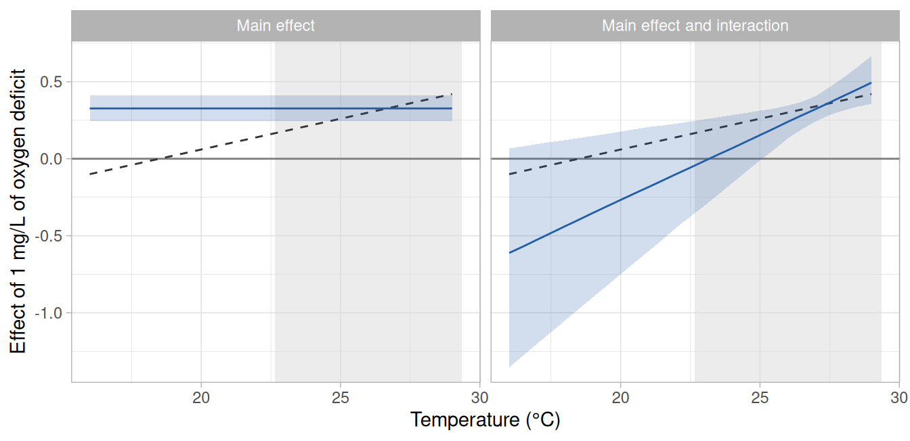
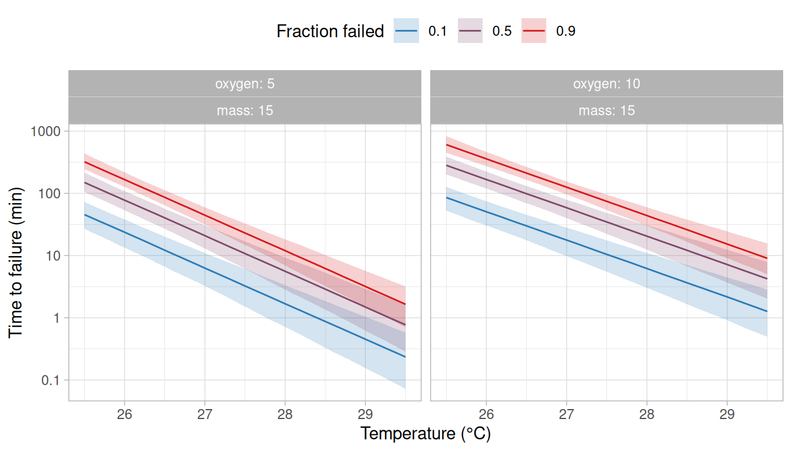
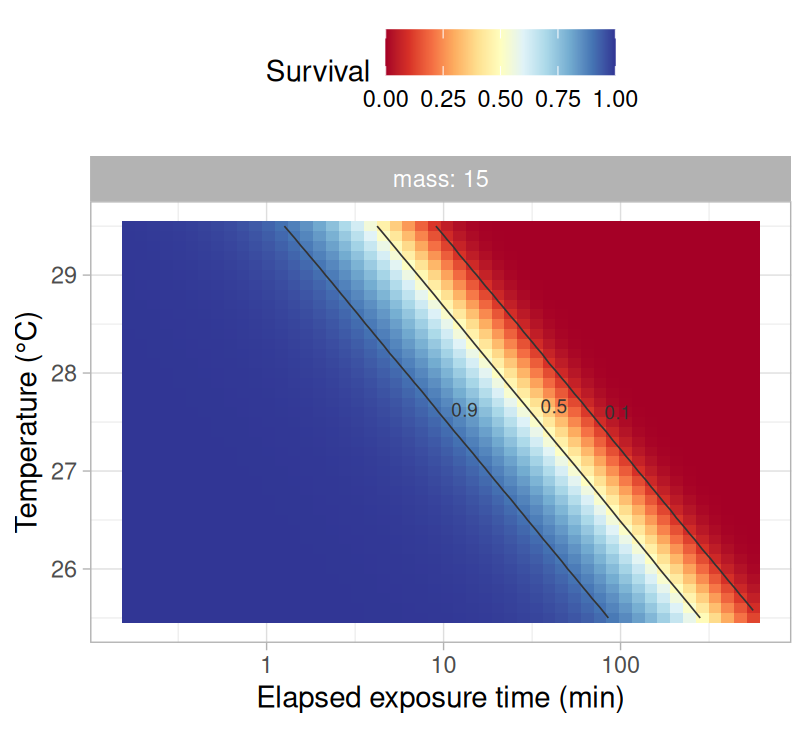
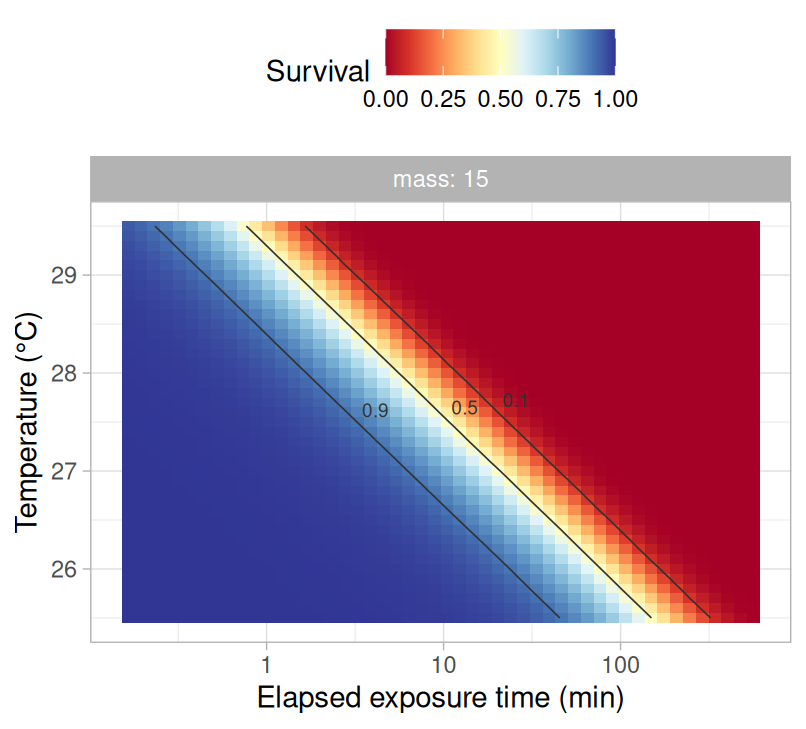
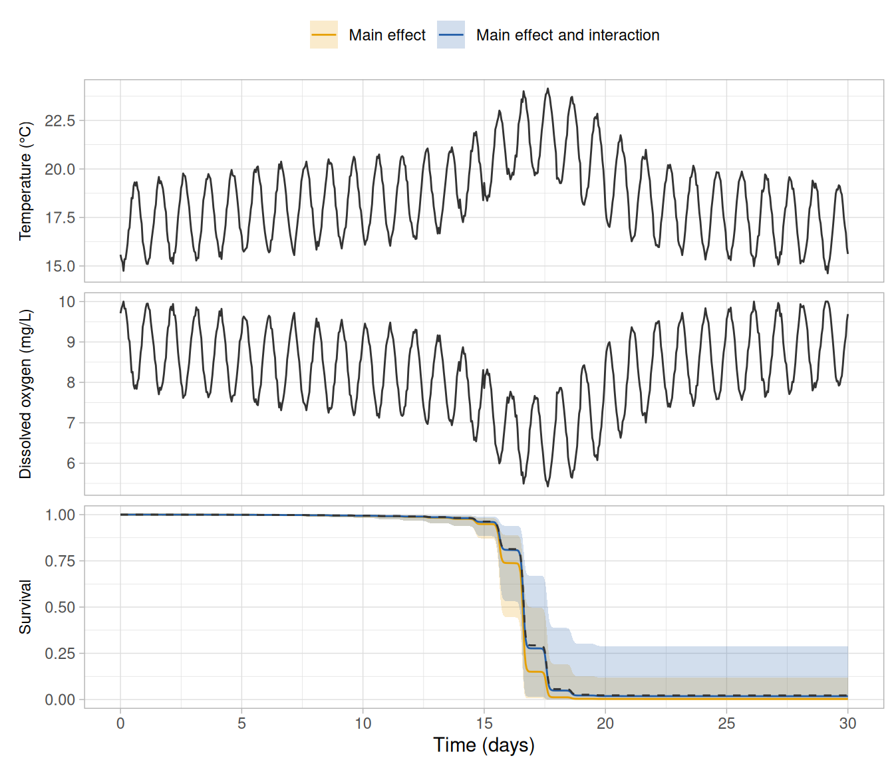

# Temperature and a co-stressor

Temperature does not always act alone. For example, fish exposed to high
temperatures may at the same time encounter low dissolved oxygen, and
below a species-specific oxygen level their upper thermal limit declines
([Ern et al. 2016](https://doi.org/10.1242/jeb.143495)). In `rTFT`, a
second environmental variable of this kind is declared as a co-stressor,
and the failure rate then depends on both temperature and the
co-stressor.

In this vignette, we fit two models to a ramping assay that was run at
two levels of dissolved oxygen: one in which oxygen changes the failure
rate by the same proportion at every temperature, and one in which its
effect also changes with temperature (i.e., an interaction). We then:
(i) derive the critical thermal maxima, the thermal death time curves
and the thermal tolerance landscape at chosen levels of oxygen, and (ii)
predict survival along a record of stream temperature and dissolved
oxygen. We also show what an interaction between temperature and a
co-stressor implies when a model is used to predict at temperatures
below those of the assay. The steps shared with the previous vignettes
are described in [*Getting started with
rTFT*](https://eogmartins.github.io/rTFT/articles/getting-started.md)
and [*Ramping
assays*](https://eogmartins.github.io/rTFT/articles/ramping-assays.md).

``` r

library(rTFT)
library(ggplot2)
```

## The assay

We use the 240 fish of `ramp_assay` that were warmed at 0.025, 0.1 or
0.3°C per min, which are the rates with the wider span in the vignette
[*Ramping
assays*](https://eogmartins.github.io/rTFT/articles/ramping-assays.md).
Each rate was run in four trials of ten fish in normoxia (10 mg/L of
dissolved oxygen) and four in hypoxia (5 mg/L), so the rates and the
levels of oxygen are fully crossed. The oxygen of each trial is in the
column `do`.

``` r

rates <- c(0.025, 0.1, 0.3)
ramp  <- subset(ramp_assay, rate %in% rates)
ramp$ctmax <- 14 + ramp$rate * ramp$t_event
observed <- ramp |>
  dplyr::summarise(
    n_fish       = dplyr::n(),
    n_failed     = sum(event),
    median_ctmax = median(ctmax),
    .by = c(rate, do)
  ) |>
  dplyr::arrange(rate, dplyr::desc(do))
observed
#> # A tibble: 6 × 5
#>    rate    do n_fish n_failed median_ctmax
#>   <dbl> <dbl>  <int>    <int>        <dbl>
#> 1 0.025    10     40       40         26.6
#> 2 0.025     5     40       40         25.7
#> 3 0.1      10     40       40         27.6
#> 4 0.1       5     40       40         27.1
#> 5 0.3      10     40       35         28.7
#> 6 0.3       5     40       40         28.0
```

At each of the three rates, the median CTmax was lower in hypoxia than
in normoxia, by 0.5–0.9°C.

> **Note**
>
> The data were simulated (see
> [`?ramp_assay`](https://eogmartins.github.io/rTFT/reference/ramp_assay.md)).
> In the model used to simulate them, low oxygen raises the failure
> rate, and the more so the warmer the water: each mg/L of oxygen below
> 10 mg/L adds 0.30 to the logarithm of the failure rate at 26°C, and
> this effect changes by 0.04 for each degree (i.e., it is 0.22 at 24°C
> and 0.38 at 28°C). The effect of oxygen is therefore a straight line
> in temperature, which is the form of the interaction fitted in this
> vignette, and it reaches zero at 18.5°C.

## Dissolved oxygen as a co-stressor

A co-stressor is declared with the function
[`costressor()`](https://eogmartins.github.io/rTFT/reference/costressor.md),
which requires three choices that have no safe default: the reference
level at which the co-stressor is known or expected to add no stress
(`ref`), the unit in which its effect is expressed (`scale`) and whether
more or less of it is more stressful (`direction`). For dissolved oxygen
we take normoxia as the reference (10 mg/L), express the effect per 1
mg/L, and set the direction to −1 because less oxygen is more stressful.

``` r

DO <- costressor("DO", column = "do", ref = 10, scale = 1, direction = -1)
```

With these choices the model uses the oxygen deficit,
$`z = 10 - \mathrm{DO}`$ (i.e., 0 in normoxia and 5 at 5 mg/L; this
$`z`$ is the package’s name for a standardised co-stressor, and not the
$`z`$ of the thermal death time curves), and the failure rate becomes

``` math
\log M(T, z) = \log a + b (T - T_r) + c \, z .
```

At the reference ($`z = 0`$) the model is the one of the previous
vignettes, so $`a`$ and $`b`$ keep their meaning and describe a fish in
normoxia. The main effect $`c`$ (the parameter `cDO`) is the change in
the logarithm of the failure rate for each mg/L of oxygen deficit, so
each mg/L of deficit multiplies the failure rate by $`\exp(c)`$, at
every temperature.

A co-stressor may also interact with temperature, which is asked for
with `interaction = TRUE`.

``` r

DO_interaction <- costressor("DO", column = "do", ref = 10, scale = 1, direction = -1,
                             interaction = TRUE)
```

The failure rate then has a further term,

``` math
\log M(T, z) = \log a + b (T - T_r) + c \, z + d \, (T - T_r) \, z ,
```

in which the interaction $`d`$ (the parameter `dTDO`) is the change in
the effect of oxygen for each degree above the reference temperature
$`T_r`$. With $`d > 0`$ the effect of low oxygen is stronger at higher
temperatures, and $`c`$ is its effect at the reference temperature.

## The table of intervals at risk

The co-stressor is given to
[`build_hazard_data()`](https://eogmartins.github.io/rTFT/reference/build_hazard_data.md),
which adds the column `z_DO` with the oxygen deficit of each row. Here
oxygen was constant within a trial, so it is read from the column `do`
of the fish. A co-stressor that changes during a trial is given as a
table of its values through time, as temperature is (see the argument
`trajectory` in
[`?costressor`](https://eogmartins.github.io/rTFT/reference/costressor.md)).

``` r

path <- ramp_path(c("r0.025", "r0.1", "r0.3"), T_start = 14, rate = rates,
                  t_max = 15.5 / rates)
long <- build_hazard_data(ramp, path, observation = "continuous",
                          covariates = c("mass", "trial"), costressors = list(DO))
unique(long[c("path_id", "z_DO")])
#> # A tibble: 6 × 2
#>   path_id  z_DO
#>   <chr>   <dbl>
#> 1 r0.1        0
#> 2 r0.1        5
#> 3 r0.3        0
#> 4 r0.3        5
#> 5 r0.025      0
#> 6 r0.025      5
```

## Fitting

The same list of co-stressors is given to
[`fit_hazard()`](https://eogmartins.github.io/rTFT/reference/fit_hazard.md).
We fit the model of the previous vignettes (an exponential failure rate
with a Weibull baseline, with $`\log a`$ depending on body mass and
varying among trials) with oxygen entering in each of the two ways. The
table of intervals at risk is the same for both, because it holds the
oxygen deficit whichever way oxygen enters the model.

``` r

formulas <- list(loga = ~ 1 + I(mass - 15) + (1 | trial))
fit_main <- fit_hazard(
  long,
  m_form        = "exp",
  baseline      = "weibull",
  dpar_formulas = formulas,
  costressors   = list(DO),
  chains = 4, iter = 2000, warmup = 1000, cores = 4, seed = 20261006,
  control = list(adapt_delta = 0.95), backend = "cmdstanr"
)
fit_interaction <- fit_hazard(
  long,
  m_form        = "exp",
  baseline      = "weibull",
  dpar_formulas = formulas,
  costressors   = list(DO_interaction),
  chains = 4, iter = 2000, warmup = 1000, cores = 4, seed = 20261006,
  control = list(adapt_delta = 0.95), backend = "cmdstanr"
)
```

The default priors of the parameters of the co-stressor are shown by
[`build_hazard_prior()`](https://eogmartins.github.io/rTFT/reference/build_hazard_prior.md)
when it is given the same list (see
[`?build_hazard_prior`](https://eogmartins.github.io/rTFT/reference/build_hazard_prior.md)).
The sampler settings are those chosen in the vignette [*Getting started
with
rTFT*](https://eogmartins.github.io/rTFT/articles/getting-started.md)
and were not tuned for these models. Fitting the two models takes about
an hour, so the code of this vignette that uses the fitted models was
run once and its results were saved with the package (see the note at
the end of this vignette).

| Model | Largest R-hat | Smallest bulk ESS | Smallest tail ESS | Divergent transitions | Times outside the band | P (residuals) |
|:---|---:|---:|---:|---:|---:|---:|
| Main effect | 1.002 | 987 | 1448 | 0 | 16 of 916 | 0.60 |
| Main effect and interaction | 1.005 | 894 | 1134 | 0 | 10 of 916 | 0.54 |

Table 1: Convergence of the two models (the largest $`\hat{R}`$, the
smallest bulk and tail effective sample sizes among the parameters and
the number of divergent transitions) and their fit to the data (the
number of observation times, among those of every ramp and level of
oxygen, at which the proportion of fish observed to survive was outside
the 95% band of the proportions simulated from the model, and the
P-value of a Kolmogorov–Smirnov test of the residuals against the
uniform distribution).

Both models converged, with no divergent transitions
([Table 1](#tbl-convergence)). The two checks of fit were made as in the
vignette [*Getting started with
rTFT*](https://eogmartins.github.io/rTFT/articles/getting-started.md),
with the proportion of fish surviving compared for each ramp at each
level of oxygen (`check_survival(fit, by = "z_DO")`). The proportion
observed was outside the simulated band at 10 of the 916 observation
times under the model with the interaction and at 16 under the model
with the main effect alone; a difference of that size is no evidence
that one model describes the data better than the other, and the two
could be compared by cross-validation as in the vignette [*Comparing and
averaging
models*](https://eogmartins.github.io/rTFT/articles/comparing-and-averaging-models.md).

## The effect of oxygen

The parameters are obtained with
[`derive_tdt_ttl()`](https://eogmartins.github.io/rTFT/reference/derive_tdt_ttl.md),
which for a model with a co-stressor requires the level of the
co-stressor at which the derived quantities are reported (`levels`), on
its measurement scale.

``` r

tol <- derive_tdt_ttl(fit_interaction, newdata = data.frame(mass = 15), t_ref = 60,
                           levels = c(DO = 10), Ta = seq(25.5, 29.5, by = 0.1))
tol$params
```

| Parameter | Simulated | Main effect | Main effect and interaction |
|:---|---:|---:|---:|
| a | 2.79 | 3.13 (2.17–4.34) | 3.26 (2.28–4.61) |
| b (per °C) | 1.70 | 1.81 (1.62–2.00) | 1.65 (1.43–1.87) |
| k | 1.50 | 1.52 (1.30–1.79) | 1.57 (1.33–1.85) |
| Main effect of oxygen | 0.35 | 0.33 (0.25–0.41) | 0.34 (0.26–0.42) |
| Interaction with temperature | 0.04 |  | 0.08 (0.02–0.15) |

Table 2: Parameters of the two models for a fish of 15 g in normoxia
(posterior medians and 95% credible intervals), with the values of the
model used to simulate the data. The main effect of oxygen is per mg/L
of oxygen deficit, and its interaction with temperature per mg/L and per
°C. For the main effect, the simulated value is the effect of oxygen at
the reference temperature of the fitted models.

In the model with the main effect alone, the effect of oxygen was 0.33
per mg/L (95% credible interval: 0.25–0.41), which is on the scale of
the logarithm of the failure rate. Its exponential is the factor by
which each mg/L of oxygen deficit multiplied the failure rate:
$`\exp(0.33)`$ = 1.4 (1.3–1.5), at every temperature
([Table 2](#tbl-params)). A deficit of several mg/L multiplies the
failure rate by that factor once for each mg/L (e.g., by
$`\exp(5 \times 0.33)`$ = 5.1 for the 5 mg/L of deficit of the trials in
hypoxia).

In the model with the interaction, the effect was 0.34 per mg/L
(0.26–0.42) at the reference temperature (27.1°C) and increased by 0.08
(0.02–0.15) for each degree, with a posterior probability of 0.997 that
the interaction is positive. Low oxygen was therefore more harmful at
higher temperatures, as it is in the model used to simulate the data.
The estimate of the interaction was about twice the simulated value
(0.04), which is within its credible interval.

What each model implies for temperatures other than those of the assay
is seen by computing the effect of oxygen on the failure rate across
temperatures. The function
[`M_draws()`](https://eogmartins.github.io/rTFT/reference/M_draws.md)
returns the posterior draws of the failure rate $`M`$ at given
temperatures and levels of the co-stressor (the rate itself, and not its
logarithm). The effect of 1 mg/L of oxygen deficit at a temperature is
the difference between the logarithm of the failure rate at 9 mg/L and
that at 10 mg/L (i.e., $`\log M_9 - \log M_{10} = \log(M_9 / M_{10})`$),
which we compute for each posterior draw and summarise by its median and
95% credible interval.

``` r

# The effect of 1 mg/L of oxygen deficit on the logarithm of the failure rate, at
# each temperature, from a fitted model.
oxygen_effect <- function(fit) {
  temperatures <- seq(16, 29, by = 0.5)
  fish     <- data.frame(mass = 15)
  normoxia <- M_draws(fit, Ta = temperatures, newdata = fish, levels = c(DO = 10),
                      n_draws = 1000)
  deficit  <- M_draws(fit, Ta = temperatures, newdata = fish, levels = c(DO = 9),
                      n_draws = 1000)
  normoxia$effect <- log(deficit$M / normoxia$M)
  normoxia |>
    dplyr::summarise(
      median = median(effect),
      lower  = quantile(effect, 0.025),
      upper  = quantile(effect, 0.975),
      .by = Ta
    )
}
effect <- rbind(
  data.frame(model = "Main effect", oxygen_effect(fit_main)),
  data.frame(model = "Main effect and interaction", oxygen_effect(fit_interaction))
)
```

``` r

effect$model <- factor(effect$model, levels = unique(effect$model))
# the temperatures at which fish failed in the assay
failed_at <- range(ramp$ctmax[ramp$event == 1])
# the effect in the model used to simulate the data
simulated_effect <- data.frame(Ta = seq(16, 29, by = 0.5))
simulated_effect$effect <- truth$b_do + truth$d_do * (simulated_effect$Ta - truth$T_ref)

ggplot(effect, aes(x = Ta)) +
  annotate("rect", xmin = failed_at[1], xmax = failed_at[2], ymin = -Inf, ymax = Inf,
           fill = "grey85", alpha = 0.5) +
  geom_hline(yintercept = 0, colour = "grey50") +
  geom_line(data = simulated_effect, aes(y = effect), linetype = "dashed", colour = "grey20") +
  geom_ribbon(aes(ymin = lower, ymax = upper), fill = "#225EA8", alpha = 0.2) +
  geom_line(aes(y = median), colour = "#225EA8") +
  facet_wrap(vars(model)) +
  labs(x = "Temperature (°C)", y = "Effect of 1 mg/L of oxygen deficit") +
  theme_light()
```



Figure 1: Effect of 1 mg/L of oxygen deficit on the logarithm of the
failure rate, across temperatures, under each of the two models. Lines
are posterior medians and bands are 95% credible intervals. The dashed
line is the effect in the model used to simulate the data, and the solid
grey line marks no effect. The shaded area covers the temperatures at
which fish failed in the assay.

In [Figure 1](#fig-effect), the horizontal axis is temperature and the
vertical axis is what 1 mg/L of oxygen deficit adds to the logarithm of
the failure rate at that temperature. A value above zero means that low
oxygen raises the failure rate (e.g., a value of 0.4 multiplies it by
$`\exp(0.4)`$ = 1.5), a value of zero that it has no effect, and a value
below zero that it lowers the failure rate. Under the model with the
main effect alone the effect is the same at every temperature, so its
line is horizontal by construction. Under the model with the interaction
it is a straight line whose slope is the interaction $`d`$.

Within the temperatures at which most fish failed, the model with the
interaction recovered the effect used to simulate the data: at 28°C it
was 0.41 (0.31–0.53), against a simulated 0.38
([Figure 1](#fig-effect)). Below those temperatures, the credible band
widens with the distance from them, because the interaction makes the
effect of oxygen a straight line in temperature that is estimated where
the fish failed and extended from there. In this assay the interaction
was estimated to be steeper than the simulated one, so the fitted line
crosses zero between 23.0 and 23.5°C, which the stream reaches during
its heat wave (see below), whereas the simulated line does so at 18.5°C.
At 20°C the model gave an effect of −0.27 (95% credible interval: −0.75
to 0.18), against a simulated 0.06. The interval includes the simulated
value, and it also includes no effect of oxygen and effects of the
opposite sign, with a posterior probability of 0.88 that low oxygen
lowers the failure rate at that temperature. These estimates come from a
single simulated assay. Among many assays simulated from the same model,
the estimates of the interaction are expected to be distributed around
the simulated value, and the estimate from any one of them departs from
it by chance, by an amount that its credible interval describes.

The model with the main effect alone applies one value to every
temperature. Its effect of 0.33 is close to the simulated effect at the
reference temperature (0.35 at 27.1°C), around which most fish failed,
and is larger than the simulated effect at the temperatures of a stream
(e.g., 0.06 at 20°C). Its credible band has the same width at every
temperature, including those at which no fish failed.

## Thermal tolerance at chosen levels of oxygen

The derived quantities are obtained at any level of the co-stressor by
giving it in `levels`.
[`derive_dctmax()`](https://eogmartins.github.io/rTFT/reference/derive_dctmax.md)
takes the same argument.

``` r

fish   <- data.frame(mass = 15)
tol_10 <- derive_tdt_ttl(fit_interaction, newdata = fish, t_ref = 60, levels = c(DO = 10),
                         Ta = seq(25.5, 29.5, by = 0.1))
tol_5  <- derive_tdt_ttl(fit_interaction, newdata = fish, t_ref = 60, levels = c(DO = 5),
                         Ta = seq(25.5, 29.5, by = 0.1))
dct_5  <- derive_dctmax(fit_interaction, rate = c(0.1, 0.3), T_start = 14, newdata = fish,
                        levels = c(DO = 5))
```

| Model | Oxygen (mg/L) | sCTmax, 60 min | dCTmax, 0.1°C per min | dCTmax, 0.3°C per min |
|:---|---:|---:|---:|---:|
| Main effect | 10 | 27.0 (26.7–27.3) | 27.8 (27.7–28.0) | 28.8 (28.6–28.9) |
| Main effect | 5 | 26.1 (25.8–26.4) | 27.0 (26.8–27.1) | 27.9 (27.7–28.1) |
| Main effect and interaction | 10 | 27.0 (26.6–27.3) | 27.8 (27.6–28.0) | 28.8 (28.6–29.1) |
| Main effect and interaction | 5 | 26.2 (25.9–26.5) | 27.0 (26.9–27.1) | 27.8 (27.6–28.0) |

Table 3: Static critical thermal maximum for an exposure of 60 min
(sCTmax) and dynamic critical thermal maximum under ramps from 14°C at
two rates (dCTmax) of a 15 g fish in normoxia and in hypoxia, from each
of the two models (posterior medians and 95% credible intervals, in °C).

Under the model with the interaction, the sCTmax for 60 min was 27.0°C
in normoxia and 26.2°C at 5 mg/L ([Table 3](#tbl-tolerance)). The two
models differed by at most 0.1°C in the sCTmax and by less in the
dCTmax, because these quantities refer to the temperatures at which the
fish failed in the assay.

The thermal death time curves at the two levels of oxygen are drawn
together by joining the tables of the two results, with a column for the
level of oxygen, which
[`plot_tdt()`](https://eogmartins.github.io/rTFT/reference/plot_tdt.md)
then treats as it treats a covariate ([Figure 2](#fig-tdt)).

``` r

both <- list(tdt_curves = rbind(
  data.frame(oxygen = 10, tol_10$tdt_curves),
  data.frame(oxygen = 5, tol_5$tdt_curves)
))
```

``` r

plot_tdt(both, time_unit = "min")
```



Figure 2: Thermal death time curves for a fish of 15 g in normoxia (10
mg/L of dissolved oxygen) and in hypoxia (5 mg/L), from the model with
the interaction of oxygen with temperature. Lines are posterior medians
and bands are 95% credible intervals.

The thermal tolerance landscape at each level of oxygen is drawn from
the corresponding result ([Figure 3](#fig-ttl)). At a given temperature,
each contour of the probability of survival is reached after a shorter
exposure in hypoxia than in normoxia.

``` r

plot_ttl(tol_10, time_unit = "min")
plot_ttl(tol_5, time_unit = "min")
```



\(a\) 10 mg/L



\(b\) 5 mg/L

Figure 3: Thermal tolerance landscape (posterior median of the
probability of survival at each constant temperature and exposure time)
for a fish of 15 g in normoxia (10 mg/L of dissolved oxygen) and in
hypoxia (5 mg/L), from the model with the interaction of oxygen with
temperature.

Any level of oxygen may be given, including levels that were not in the
assay (e.g., `levels = c(DO = 7.5)`). The assay had two levels, so what
the model gives between them or beyond them rests on the assumption that
the effect of oxygen on the logarithm of the failure rate is
proportional to the deficit, which two levels cannot test.

## Survival along a record of temperature and oxygen

For a prediction along a record, the co-stressor is given in one of two
ways. When the record has a column with the name the co-stressor was
declared with (here `do`),
[`predict_survival()`](https://eogmartins.github.io/rTFT/reference/predict_survival.md)
follows it through time as it follows temperature. Otherwise the
co-stressor is held at the level given in `levels`.

The dataset `stream_record` holds temperature only, so we add to it a
series of dissolved oxygen that falls as the stream warms: 10 mg/L at
15°C or below, and 0.5 mg/L less for each degree above 15°C.

``` r

record    <- stream_record
record$do <- pmin(10, 10 - 0.5 * (record$temp - 15))
range(record$do)
#> [1]  5.425 10.000
```

``` r

# oxygen following the record
pred_following <- predict_survival(fit_interaction, record, newdata = fish)
# oxygen held at 10 mg/L
pred_normoxia  <- predict_survival(fit_interaction, stream_record, newdata = fish,
                                   levels = c(DO = 10))
```

The record and the survival along it under each of the two models are
shown in [Figure 4](#fig-record). The survival predicted by a model is
drawn with
[`plot_survival()`](https://eogmartins.github.io/rTFT/reference/plot_survival.md),
as in the previous vignettes (e.g.,
`plot_survival(pred_following, temperature = TRUE)`).



Figure 4: Temperature and dissolved oxygen along the stream record, and
the probability of survival of a 15 g fish along it, predicted by the
model with the main effect of oxygen alone and by the model with its
interaction with temperature (lines are posterior medians and bands are
95% credible intervals). The dashed line is the survival under the model
used to simulate the data. The exposure is counted from the start of the
record.

As in the previous vignettes, we also predict the mortality over the
five days of the heat wave and over its warmest day, with the exposure
counted from the start of each period.

| Oxygen | Model | 30 days | Heat wave, 5 days | Warmest day, 24 h |
|:---|:---|---:|---:|---:|
| 10 mg/L | Main effect | 76 (45–98) \[75\] | 40 (23–65) \[41\] | 10 (5–17) \[10\] |
| 10 mg/L | Main effect and interaction | 97 (67–100) \[93\] | 68 (36–97) \[67\] | 19 (8–38) \[20\] |
| 10 mg/L | Model used to simulate the data | 81 | 45 | 12 |
| Falling as the stream warms | Main effect | 100 (88–100) \[99\] | 87 (66–98) \[86\] | 35 (23–49) \[35\] |
| Falling as the stream warms | Main effect and interaction | 98 (71–100) \[95\] | 73 (40–94) \[71\] | 23 (11–39) \[23\] |
| Falling as the stream warms | Model used to simulate the data | 98 | 75 | 26 |

Table 4: Probability (%) that a 15 g fish fails by the end of the whole
stream record, of the five days of its heat wave (days 16 to 20) and of
its warmest day (day 18), with dissolved oxygen held at 10 mg/L and with
dissolved oxygen falling as the stream warms, predicted by each of the
two models (posterior medians and 95% credible intervals, with posterior
means in brackets), with the values given by the model used to simulate
the data. For the two shorter periods, the exposure is counted from
their first reading.

Under the model used to simulate the data, the mortality over the heat
wave is 45% with oxygen at 10 mg/L and 75% with oxygen falling as the
stream warms ([Table 4](#tbl-survival)). The model with the main effect
alone predicted 40% (95% credible interval: 23–65) and 87% (66–98), and
the model with the interaction 68% (36–97) and 73% (40–94). The credible
intervals of both models include the simulated values, but the two
models differ in how much of the mortality they attribute to oxygen:
under the first, falling oxygen more than doubles the mortality over the
heat wave, and under the second it changes the mortality little. In
terms of the cumulative hazard over the heat wave, falling oxygen
multiplies it by 2.3 under the model used to simulate the data, by 4.0
under the model with the main effect alone and by 1.2 under the model
with the interaction (on the posterior medians), so the first attributes
more to oxygen than the simulating model does and the second less, while
predicting a higher mortality in normoxia.

The difference follows from the effect of oxygen that each model gives
at the temperatures of the stream, which never exceeded 24.1°C
([Figure 1](#fig-effect)). The model with the main effect alone applies
there the effect that it estimated at the temperatures at which the fish
failed, which is larger than the simulated effect at the temperatures of
the stream. The model with the interaction gives there an effect near
zero or negative, with a wide credible band. The model with the
interaction also predicted a higher mortality with oxygen at 10 mg/L,
because its thermal sensitivity $`b`$ was lower (1.65 against 1.81 per
°C; [Table 2](#tbl-params)) and a lower $`b`$ gives a higher failure
rate at temperatures below the reference temperature.

Both predictions extend the effect of oxygen to temperatures below those
at which fish failed in hypoxia in the assay (24.3°C or above), where
the assay does not show how the effect of oxygen changes with
temperature.

Under the model with the interaction and with oxygen falling, the 95%
credible interval of the mortality was narrower over the 30 days
(71–100%) than over the heat wave (40–94%). The mortality over the 30
days is therefore the more certain of the two predictions, and the
reason is the level of the hazard, not the precision with which it was
estimated. Mortality is obtained from the cumulative hazard $`H`$ as
$`1 - \exp(-H)`$ and cannot exceed 100%. Over the 30 days, the 95%
credible interval of $`H`$ was 1.3–13.5. Its upper limit was 11 times
the lower one, but most fish fail at any value within it, so the
interval of the mortality spanned 29 percentage points. Over the heat
wave, the interval of $`H`$ was 0.5–2.9. Its upper limit was only 6
times the lower one, but mortality changes the most with $`H`$ at such
intermediate values, and the interval of the mortality spanned 55
percentage points.

These predictions are extrapolations in the two ways described in the
previous vignettes: the stream is cooler than the temperatures at which
most fish failed in the assay, and the record is much longer than the
trials. They also assume that there is no recovery during the cooler
hours of each night ([Ørsted et
al. 2022](https://doi.org/10.1242/jeb.244514)). The model used to
simulate the data has the form of the fitted models at every temperature
and exposure time and makes the same assumption, so the agreement of a
prediction with the simulated value says nothing about whether the
extrapolations or the assumption hold for real fish (see the vignettes
[*Ramping
assays*](https://eogmartins.github.io/rTFT/articles/ramping-assays.md)
and [*Comparing and averaging
models*](https://eogmartins.github.io/rTFT/articles/comparing-and-averaging-models.md)).

## Design of an assay with a co-stressor

The effect of a co-stressor, and how it changes with temperature, are
informed only by the temperatures at which individuals fail, and in a
ramping assay those cover a few degrees. Within them the two models of
this vignette gave similar answers, and outside them they are two
different extrapolations: a constant effect, and a straight line that
sooner or later changes sign. We therefore recommend: (i) fitting the
model with the main effect alone as well as the model with the
interaction, and comparing what the two imply at the temperatures for
which predictions are needed ([Figure 1](#fig-effect)), in addition to
comparing them by cross-validation (see the vignette [*Comparing and
averaging
models*](https://eogmartins.github.io/rTFT/articles/comparing-and-averaging-models.md));
(ii) where the two disagree at those temperatures, reporting the
predictions of both and treating the effect of the co-stressor below the
temperatures at which individuals failed as an extrapolation; (iii)
where predictions at lower temperatures are the aim, including in the
assay trials in which individuals fail at such temperatures at each
level of the co-stressor (e.g., static trials, or ramps slow enough for
failures to occur at lower temperatures); (iv) running three or more
levels of the co-stressor where its effect at intermediate levels
matters, because with two levels the main effect is the difference
between two treatments and its proportionality to the level cannot be
assessed; and (v) running several trials of each combination of ramp
rate and level of the co-stressor, because the co-stressor is applied to
whole trials and its effect is estimated among them.

A model may have more than one co-stressor, each declared with
[`costressor()`](https://eogmartins.github.io/rTFT/reference/costressor.md)
and all given in one list. The derived quantities and the predictions
then require a level for each.

``` r

# dissolved copper, in micrograms per litre, with its effect expressed per 10 units
copper <- costressor("Cu", column = "copper", ref = 0, scale = 10, direction = 1)
long <- build_hazard_data(ind, path, observation = "continuous",
                          costressors = list(DO, copper))
fit  <- fit_hazard(long, m_form = "exp", baseline = "weibull",
                   costressors = list(DO, copper))
derive_tdt_ttl(fit, t_ref = 60, levels = c(DO = 7, Cu = 20))
```

The help page of
[`costressor()`](https://eogmartins.github.io/rTFT/reference/costressor.md)
describes the further options: a co-stressor that is harmful in both
directions from an optimum (e.g., pH), a treatment with categories in
place of a measured level, and an interaction that changes the thermal
sensitivity $`b`$ by a proportion.

> **Precomputed results**
>
> The models in this vignette were fitted on 2026-10-09 with the
> development version of `rTFT` that became 0.1.0 (0.0.0.9000), by the
> script `vignettes/_precompute.R` in the package’s repository. The
> vignette displays the saved summaries, and all other code runs when
> the vignette is built.

## References

Ern, R., Norin, T., Gamperl, A. K. and Esbaugh, A. J. (2016). Oxygen
dependence of upper thermal limits in fishes. *Journal of Experimental
Biology* 219, 3376–3383.
[https://doi.org/10.1242/jeb.143495](https://doi.org/10.1242/jeb.143495)

Ørsted, M., Jørgensen, L. B. and Overgaard, J. (2022). Finding the right
thermal limit: a framework to reconcile ecological, physiological and
methodological aspects of CTmax in ectotherms. *Journal of Experimental
Biology* 225, jeb244514.
[https://doi.org/10.1242/jeb.244514](https://doi.org/10.1242/jeb.244514)
